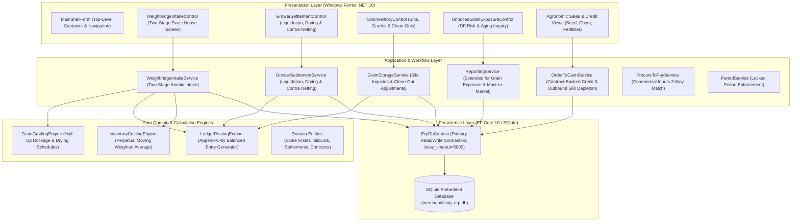
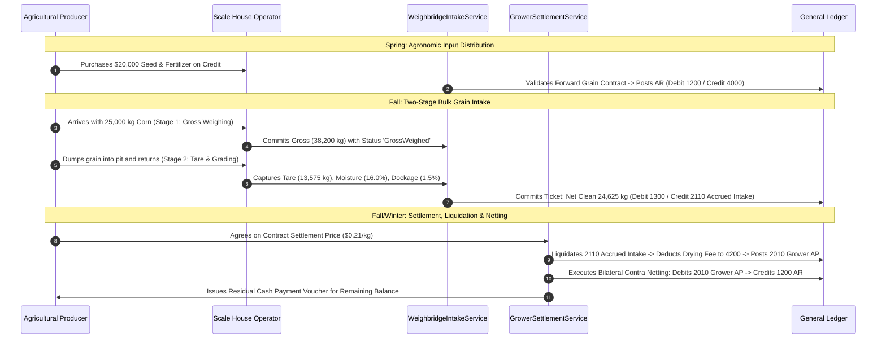

# Agricultural Merchandising ERP Accounting Application

* **Author:** Max Sainz
* **Status:** Draft
* **Date:** 2026-11-21

---

## Overview

Small-to-mid scale agricultural merchandising businesses—specifically country grain elevators and agricultural input retailers—operate a dual-lifecycle commercial business model across the farming calendar. In the spring and planting season, merchants distribute packaged agronomic inputs (certified seed sacks, bulk and tote fertilizers, crop protection chemicals) to local growers, often extending substantial seasonal trade credit. In the autumn harvest season, the same merchants switch to high-velocity bulk grain aggregation, operating weighbridge truck scales, probe sampling, dockage and moisture grading, silo aeration, and commingled storage for dry bulk crops (Corn, Soybeans, Wheat, Rice). At harvest end, merchants settle grain purchases and net farmers' outstanding spring input debts against their crop delivery proceeds.

Operating these dual lifecycles on disconnected spreadsheets or generic accounting software introduces severe financial and operational failure points: unreconciled book inventory discrepancies, moisture evaporation deficits, unhedged market price swings on unsettled scale tickets, delayed cross-subledger netting, and database write lockups during peak harvest intake.

This design document establishes the architecture for an integrated desktop ERP accounting application for agricultural merchandising. Built as a single-workstation .NET 10 / Visual Basic .NET / SQLite Windows Forms system, it extends the foundational double-entry General Ledger and perpetual inventory architecture of the Merchandising ERP while introducing specialized domain engines for weighbridge scale ticketing, two-stage provisional grain intake, automated dockage deduction, drying service revenue recognition, commingled silo lot tracking, silo clean-out moisture shrinkage write-downs, dual-tier contract-backed credit controls, and bilateral AR/AP seasonal contra-clearing.

All physical stock quantities are stored as integer kilograms (Integer kg), preserving the non-negative stock invariant (`CHECK (TotalQtyOnHand >= 0)`) without floating-point calculation errors.

---

## Problem Statement

Generic merchandising and retail ERP systems assume discrete packaged items, instantaneous invoice-to-receipt matching, and clear separation between customers and suppliers. Applying standard packaged-goods ERP logic to country grain aggregation and farm input retail causes four systemic points of failure:

1. **Intake Velocity vs. Pricing Exposure Conflict**: During peak harvest, 150 to 250 semi-trucks arrive daily at the elevator. Trucks must be weighed, graded, dumped, and tared in under three minutes to prevent scale queue backups. However, grain pricing is frequently deferred (Delayed Price / Basis contracts) or unsettled at the moment of intake. Traditional ERPs either block receiving until a purchase price is established (halting scale intake operations) or ingest unvalued stock (distorting moving average unit costs and rendering COGS undefined).
2. **Physical Commingling vs. Lot Traceability Breakdown**: Once dumped into a receiving pit, bulk grain from dozens of producers is commingled in large silos by quality grade. Standard lot-tracking systems that mandate tracking specific vendor lots throughout inventory movements force artificial lot splitting or cause inventory allocation failures. Conversely, eliminating intake tracking entirely precludes backward origin traceability when grain contaminants (e.g., aflatoxin, sour odor) are later discovered.
3. **Moisture Evaporation and Storage Shrinkage**: Grain is an active biological commodity. Aeration and ambient storage cause natural moisture loss and dust aspiration. If an elevator receives 100,000 kg of corn at 15.0% moisture and aerates it down to 13.5%, moisture evaporates during aeration. Without formal clean-out and shrinkage reconciliation, book inventory overstates physical stock, eventually causing outbound sales to fail with hard-stop stock exceptions.
4. **Seasonal Producer Counterparty Duality & Credit Default**: Local growers are simultaneously customers in the spring (purchasing seed and fertilizer on credit) and vendors in the fall (delivering grain). When standard ERPs isolate AR and AP into rigid silos, bookkeepers must issue manual checks while receivables age past 180 days. Furthermore, granting unsecured trade credit without validating the grower's committed forward harvest volume exposes the business to uncollectible trade credit losses if the grower defaults or sells elsewhere.

---

## Goals & Non-Goals

### Goals

* **High-Velocity Weighbridge Scale Intake**: Capture gross weight, tare weight, moisture percentage, and dockage percentage in a single-screen rapid UI, computing dockage kilograms via half-up rounding (`MidpointRounding.AwayFromZero`) and committing scale ticket records to the database within 250 milliseconds.
* **Two-Stage Provisional Grain Procurement Accounting**: Value inbound grain immediately at the elevator's active posted cash benchmark price (Debit `1300 Merchandise Inventory` / Credit `2110 Accrued Grower Intake`) to maintain real-time perpetual inventory valuation and permit instant outbound sales dispatch.
* **Controlled Liquidation & Variance Segregation**: Liquidate scale ticket accruals via a formal `GrowerSettlementSheet`, routing commodity contract price differences to `5110 Grain Basis & Delayed Price Variance` and recording moisture conditioning fees into `4200 Agricultural Services & Drying Revenue`.
* **Clerk-Initiated Delayed Price (DP) Liquidation**: Provide visual aging indicators and operational inquiries tracking unpriced Delayed Price scale tickets, supporting explicit operator-initiated liquidation at current posted benchmark prices with drying/storage fee deductions.
* **Commingled Silo Storage with Formal Clean-Out Reconciliation**: Commingle grain by product, grade, and harvest year in `SiloBinLots` (`CHECK (CurrentQtyKg >= 0)`), while providing an append-only inventory adjustment document (`ReasonCode = 'SiloCleanOut'`) to reconcile moisture evaporation deficits to `5350 Agricultural Commodity Moisture Shrinkage` or surpluses to `5400 Stocktake Revaluation Variance`.
* **Automated Two-Tier Recall Traceability**: Preserve granular origin data (`GrowerId`, `FarmFieldId`, `TruckPlate`, probe sample jar reference `SampleJarRef`) on intake scale tickets, enabling retrospective temporal traceability for commingled silos without attaching vendor identity to storage lots.
* **Bilateral Seasonal AR/AP Contra-Clearing**: Automate net settlements between spring input invoices (`1200 AR`) and fall grain payouts (`2010 Grower AP`) directly within the `GrowerSettlementSheet`, capturing invoice line allocations and issuing net cash payment vouchers.
* **Contract-Linked Credit Protection for Spring Inputs**: Enforce dual-tier credit limits (`UnsecuredCreditLimit` and `CropSecuredCreditLimit`), blocking spring agronomic sales that exceed unsecured limits unless backed by active, undelivered `GrainPurchaseContract` equity and verified crop lien filing.
* **Strict Integer Metric Invariant**: Enforce integer kilograms (`Integer` kg) as the atomic base unit across all bulk grains and packaged inputs, preventing floating-point rounding errors and preserving database constraints.

### Non-Goals

* **Automated Futures & Derivative Hedging**: No direct electronic order execution with commodity exchanges (e.g., CBOT/CME) or mark-to-market accounting for financial derivative positions.
* **Multi-Elevator Network Logistics**: No multi-facility transfer routing, centralized rail fleet scheduling, or in-transit inter-elevator balancing. The MVP targets a single country elevator facility.
* **Biological Asset Farming (IAS 41)**: No crop growth modeling, field planting logs, machinery depreciation tracking, or livestock accounting.
* **Industrial Milling or Food Processing (BOM/WIP)**: No conversion of raw grain into flour, animal feed rations, or ethanol.
* **Proprietary PLC/SCADA Hardware Protocols**: Direct vendor-specific hardware driver integrations (beyond standard RS-232/COM/TCP ASCII data streams) are out of scope.
* **Intra-Facility Material Handling & Milling MES**: Internal bin-to-bin transfers and grain drying processes are physical material-handling operations that generate no General Ledger entries; automated industrial MES/BOM tracking is out of scope.
* **Multi-Currency & Foreign Exchange**: All transactions and commodity prices are recorded in the single domestic base currency.

---

## Open Questions & Formal Resolutions

* **Open Question 1: How are sub-kilogram fractions from dockage percentage calculations handled without violating the integer stock invariant?**
  * *Resolution:* Scale indicator hardware measures in 5 kg or 10 kg increments. Dockage kilograms are calculated as $\text{GrossInboundKg} \times \frac{\text{ForeignMatterPct}}{100}$ and rounded to the nearest integer kilogram using `MidpointRounding.AwayFromZero`. Net clean weight is $\text{GrossInboundKg} - \text{DockageKg}$. Invariant validation enforces $\text{DockageKg} + \text{NetCleanKg} \equiv \text{GrossInboundKg}$, ensuring zero loss of measured mass.
* **Open Question 2: How does the system handle grain pricing that occurs across accounting periods?**
  * *Resolution:* Scale tickets post at the delivery date's posted cash benchmark price against `2110 Accrued Grower Intake` in the open period. When the `GrowerSettlementSheet` is posted in a subsequent open period, `2110` is cleared at the provisional value, the true liability is recognized in `2010 Grower AP`, and the difference posts to `5110 Grain Basis & Delayed Price Variance` in the current open period. Past closed periods are never altered.
* **Open Question 3: How does the business display bushels to growers while maintaining integer kilograms in the database?**
  * *Resolution:* Database columns, ledger entries, and inventory movements operate strictly in integer kilograms. The Windows Forms UI dynamically displays virtual bushel equivalents on screen using standard test weight conversion constants (e.g., 25.4012 kg/bu for Corn, 27.2155 kg/bu for Soybeans/Wheat) as read-only calculated presentation fields.

---

## Critical User Journeys (CUJs)

### CUJ 1: High-Velocity Inbound Grain Receiving & Scale Ticket Intake
* **Given**: A grower arrives at the elevator scale deck with a semi-truck loaded with yellow corn. The active posted cash benchmark price on `Products` is $0.20/kg.
* **When**: 
  1. *Stage 1 (Gross Weighing)*: The scale clerk captures Gross Weight (38,200 kg) and vehicle metadata (`TruckPlate`), saving the ticket with status `GrossWeighed`.
  2. *Stage 2 (Tare & Grading)*: The truck dumps into Pit A (routed to Silo 04) and returns to the scale deck. The probe operator inputs 15.5% moisture, 1.8% foreign matter, and probe jar ID `JAR-2026-104`. The clerk captures Tare Weight (14,200 kg) and commits the ticket.
* **Then**: 
  * $\text{Gross Inbound Kg} = 38,200 - 14,200 = 24,000\text{ kg}$.
  * $\text{Dockage Kg} = \text{Round}(24,000 \times 0.018) = 432\text{ kg}$ (half-up rounding).
  * $\text{Net Clean Kg} = 24,000 - 432 = 23,568\text{ kg}$.
  * `WeighbridgeScaleTicket` transitions to status `PendingSettlement`.
  * Database atomically updates `Products.TotalQtyOnHand` ($+23,568\text{ kg}$) and `SiloBinLots.CurrentQtyKg` ($+23,568\text{ kg}$).
  * A General Ledger journal entry posts: Debit `1300 Merchandise Inventory` $4,713.60 ($23,568\text{ kg} \times \$0.20$), Credit `2110 Accrued Grower Intake` $4,713.60.
  * Clean corn is immediately available for outbound dispatch.

### CUJ 2: Fall Grower Settlement Sheet with Drying Revenue & Contra-Clearing
* **Given**: Grower John Doe delivered 50,000 net clean kg of corn across two scale tickets accrued at $0.20/kg ($10,000.00 in `2110 Accrued Grower Intake`). The agreed settlement contract price is $0.21/kg ($10,500.00 gross value). Moisture conditioning fees total $350.00. The grower has an unpaid spring fertilizer invoice of $4,200.00 in `1200 AR`.
* **When**: The grain accountant generates and posts a `GrowerSettlementSheet` with selected contra invoice allocations.
* **Then**:
  * The settlement sheet liquidates provisional intake: Debit `2110 Accrued Grower Intake` $10,000.00.
  * Price variance is recognized: Debit `5110 Grain Basis & Delayed Price Variance` $500.00.
  * Drying revenue is recognized: Credit `4200 Agricultural Services & Drying Revenue` $350.00.
  * Gross grower liability is recognized: Credit `2010 Grower AP` $10,150.00.
  * Bilateral contra netting applies directly: Debit `2010 Grower AP` $4,200.00, Credit `1200 AR` $4,200.00 (closing spring invoice #INV-10492).
  * A Payment Voucher disburses the net cash balance: Debit `2010 Grower AP` $5,950.00, Credit `1020 Operating Bank Account` $5,950.00.

### CUJ 3: Spring Agronomic Input Sale with Contract-Linked Credit Guard
* **Given**: Grower Jane Smith has an `UnsecuredCreditLimit` of $5,000.00, a `CropSecuredCreditLimit` of $50,000.00, and an existing AR balance of $1,200.00. She orders $28,000.00 of bulk fertilizer and seed bags. Jane has an active `GrainPurchaseContract` committing 200,000 kg of fall corn at a minimum contract base price of $0.19/kg ($38,000.00 forward value), with 0 kg delivered to date.
* **When**: The sales representative attempts to post the sales invoice for $28,000.00.
* **Then**:
  * Total proposed AR is $\$1,200.00 + \$28,000.00 = \$29,200.00$, exceeding `UnsecuredCreditLimit` ($5,000.00).
  * `OrderToCashService` verifies that proposed AR ($29,200.00) $\le$ `CropSecuredCreditLimit` ($50,000.00).
  * `OrderToCashService` calculates Remaining Undelivered Contract Equity: $(200,000\text{ kg} - 0\text{ kg}) \times \$0.19/\text{kg} = \$38,000.00$.
  * Excess credit requested ($\$29,200.00 - \$5,000.00 = \$24,200.00$) is verified to be $\le \$38,000.00$.
  * Active crop lien filing metadata (`HasCropLienFiling = True`) is verified.
  * The sales invoice posts: Debit `1200 AR` $28,000.00, Credit `4000 Sales Revenue` $28,000.00; inventory and COGS update based on packaging multipliers.

### CUJ 4: Outbound Commercial Grain Dispatch & Silo Lot Depletion
* **Given**: A grain buyer purchases 50,000 kg of yellow corn at $0.24/kg ($12,000.00). Silo 04 contains 100,000 kg of yellow corn at a moving average unit cost of $0.20/kg.
* **When**: The sales dispatcher posts the commercial sales invoice, selecting Silo 04 (`LotId = 4`) on the invoice line.
* **Then**:
  * `OrderToCashService` atomically decrements both `Products.TotalQtyOnHand` ($-50,000\text{ kg}$) and `SiloBinLots.CurrentQtyKg` ($-50,000\text{ kg}$) for Lot 4 under `CHECK (CurrentQtyKg >= 0)`.
  * General Ledger entries post: Debit `1200 AR` $12,000.00 / Credit `4000 Sales Revenue` $12,000.00; Debit `5000 COGS` $10,000.00 ($50,000\text{ kg} \times \$0.20$) / Credit `1300 Merchandise Inventory` $10,000.00.
  * Silo 04 remaining quantity updates to 50,000 kg, maintaining exact parity between General Ledger inventory and bin-level physical stock.

---

## Proposed Architecture

### 1. System Architecture Overview

The application follows the strict four-layer architecture established in `GEMINI.md`: Presentation, Application Services, Pure Domain Engines, and Persistence. It targets .NET 10.0 Windows Forms on Windows x64 with an embedded SQLite database (`Microsoft.EntityFrameworkCore.Sqlite`) in WAL mode.



---

### 2. Dual-Lifecycle Operational Workflow



---

### 3. Component Breakdown & Responsibilities

#### 3.1 Presentation Layer
* **`WeighbridgeIntakeControl`**: Streamlined single-screen scale house interface designed for rapid operations. Displays Gross Weight, Tare Weight, Net Inbound Kg, Moisture %, Foreign Matter %, Dockage Kg, and Net Clean Kg. Supports two-stage ticketing (Gross commit $\rightarrow$ Tare completion), displays calculated virtual bushel equivalents, and supports keyboard wedge weight capture and fast keyboard navigation.
* **`GrowerSettlementControl`**: Multi-ticket liquidation workspace. Loads unsettled scale tickets for a selected grower, applies contracted unit price, computes moisture drying fee deductions, displays open AR sales invoices for contra allocation, and renders previewed debit/credit distribution lines.
* **`SiloInventoryControl`**: Visual bin-board showing active capacity, commodity grade, current on-hand weight (kg), and average unit cost for each physical silo. Provides action triggers for silo clean-out inventory adjustments.
* **`UnpricedGrainExposureControl`**: Managerial dashboard tracking unsettled Delayed Price (DP) scale tickets in Account `2110 Accrued Grower Intake`, displaying delivery dates, days unpriced, contract expiration countdowns, and mark-to-market margin exposure based on daily posted benchmark bids.

#### 3.2 Application Services
* **`WeighbridgeIntakeService`**: Orchestrates two-stage atomic scale ticketing:
  1. *Stage 1*: Inserts `WeighbridgeScaleTicket` with `GrossWeightKg`, `TruckPlate`, and `Status = 'GrossWeighed'`.
  2. *Stage 2*: Computes dockage and net clean weight via `GrainGradingEngine`, updates ticket with tare, dockage, sample jar ID, and transitions status to `PendingSettlement`.
  3. Increments `Products.TotalQtyOnHand` and `SiloBinLots.CurrentQtyKg` atomically.
  4. Generates and inserts balanced `JournalEntry` (Debit `1300 Merchandise Inventory` / Credit `2110 Accrued Grower Intake`).
  5. Increments `GrainPurchaseContracts.DeliveredQtyKg` if an associated contract is linked.
* **`GrowerSettlementService`**: Handles financial liquidation of scale tickets and seasonal netting:
  1. Reconciles liquidated scale tickets against contracted unit price.
  2. Liquidates `2110 Accrued Grower Intake` at provisional delivery cost.
  3. Routes pricing differences bidirectionally to `5110 Grain Basis & Delayed Price Variance`.
  4. Deducts drying and storage charges, crediting `4200 Agricultural Services & Drying Revenue`.
  5. Recognizes gross liability in `2010 Grower Accounts Payable`.
  6. Applies selected AR invoice allocations, debiting `2010 Grower AP` and crediting `1200 Accounts Receivable` directly, closing settled sales invoices.
* **`GrainStorageService`**: Manages physical silo inventory and clean-outs:
  1. Queries real-time silo inventory balances, capacities, and lot moving average costs.
  2. Executes silo clean-out write-downs via the standard `InventoryService.RecordInventoryAdjustment` pipeline with `ReasonCode = 'SiloCleanOut'`, debiting `5350 Agricultural Commodity Moisture Shrinkage` for evaporation deficits or crediting `5400 Stocktake Revaluation Variance` for physical surpluses.
* **`OrderToCashService` (Extended)**:
  1. Enforces dual-tier credit check during sales invoice creation:
     $$\text{Effective AR} = \text{Current AR Balance} + \text{Pending Invoice Total}$$
     $$\text{Enforce: } \text{Effective AR} \le \text{CropSecuredCreditLimit}$$
     $$\text{If } \text{Effective AR} > \text{UnsecuredCreditLimit}: \text{Require } \sum\left((\text{ContractedQtyKg} - \text{DeliveredQtyKg}) \times \text{BasePricePerKg}\right) \ge (\text{Effective AR} - \text{UnsecuredCreditLimit})$$
  2. Verifies presence of statutory crop lien filing (`HasCropLienFiling = True`) before authorizing credit sales exceeding unsecured limits.
  3. When fulfilling commercial grain sales invoices, atomically decrements both `Products.TotalQtyOnHand` and `SiloBinLots.CurrentQtyKg` using the line's `SiloBinLotId`.

#### 3.3 Pure Domain Engines
* **`GrainGradingEngine`**: Stateless mathematical calculation engine enforcing standard agronomic formulas and rounding invariants:
  $$\text{GrossInboundKg} = \text{GrossWeightKg} - \text{TareWeightKg}$$
  $$\text{RawDockageKg} = \text{GrossInboundKg} \times \frac{\text{ForeignMatterPct}}{100}$$
  $$\text{DockageKg} = \text{CInt}\left(\text{Math.Round}(\text{RawDockageKg}, \text{MidpointRounding.AwayFromZero})\right)$$
  $$\text{NetCleanKg} = \text{GrossInboundKg} - \text{DockageKg}$$
  $$\text{MoistureDeductionAmount} = \text{NetCleanKg} \times \text{LookupDryingRate}(\text{CommodityId}, \text{MoisturePct})$$
* **`LedgerPostingEngine` (Extended)**:
  - Added Rule 11: `GenerateScaleTicketIntakeJournal` (Debit `1300`, Credit `2110`).
  - Added Rule 12: `GenerateGrowerSettlementJournal` (Debit `2110`, bidirectional `5110`, Credit `4200`, Credit `2010`, Debit `2010`, Credit `1200`).
  - Added Rule 13: `GenerateSiloCleanOutJournal` (Debit `5350` / Credit `1300` for shrinkage; Debit `1300` / Credit `5400` for surplus).

---

## Database Relational Schema DDL

The database schema builds upon the 25 existing core tables in `mvp_erp_accounting.md`, adding 4 specialized tables (`WeighbridgeScaleTickets`, `SiloBinLots`, `GrainPurchaseContracts`, `GrowerSettlementSheets` / lines), 2 lookup/schedule tables (`GrainDryingRates`, `GrowerSettlementInvoiceAllocations`), and altering 3 existing entities (`Customers`, `Products`, `SalesInvoiceLines`).

```sql
-- ============================================================================
-- 1. Weighbridge Scale Tickets (Two-Stage Inbound Grain Intake)
-- ============================================================================
CREATE TABLE WeighbridgeScaleTickets (
    TicketId INTEGER PRIMARY KEY AUTOINCREMENT,
    TicketNumber VARCHAR(35) NOT NULL UNIQUE,
    GrowerId INTEGER NOT NULL,
    FarmFieldId INTEGER NULL,
    TruckPlate VARCHAR(20) NOT NULL,
    GrossWeightKg INTEGER NOT NULL,
    TareWeightKg INTEGER NULL,
    GrossInboundKg INTEGER NULL,
    MoisturePct DECIMAL(5,2) NOT NULL DEFAULT 0.00,
    ForeignMatterPct DECIMAL(5,2) NOT NULL DEFAULT 0.00,
    DockageKg INTEGER NULL,
    NetCleanKg INTEGER NULL,
    SampleJarRef VARCHAR(50) NULL,
    CommodityProductId INTEGER NOT NULL,
    TargetSiloBinLotId INTEGER NOT NULL,
    PricingType VARCHAR(25) NOT NULL, -- 'SpotCash', 'ContractFixed', 'DelayedPrice'
    AssociatedContractId INTEGER NULL,
    ProvisionalUnitPrice DECIMAL(18,4) NOT NULL DEFAULT 0.0000,
    ProvisionalTotalAmount DECIMAL(18,4) NOT NULL DEFAULT 0.0000,
    Status VARCHAR(25) NOT NULL DEFAULT 'GrossWeighed', -- 'GrossWeighed', 'PendingSettlement', 'Settled', 'Voided'
    ReceiptDate DATETIME NOT NULL,
    PostingDate DATETIME NOT NULL,
    DelayedPriceExpiryDate DATETIME NULL,
    CreatedBy VARCHAR(50) NOT NULL,
    CreatedAt DATETIME NOT NULL DEFAULT CURRENT_TIMESTAMP,
    CONSTRAINT CK_ScaleTicket_Weights CHECK (TareWeightKg IS NULL OR GrossWeightKg >= TareWeightKg),
    CONSTRAINT CK_ScaleTicket_GrossInbound CHECK (GrossInboundKg IS NULL OR GrossInboundKg = GrossWeightKg - TareWeightKg),
    CONSTRAINT CK_ScaleTicket_NetClean CHECK (NetCleanKg IS NULL OR NetCleanKg = GrossInboundKg - DockageKg),
    CONSTRAINT CK_ScaleTicket_NonNegativeNet CHECK (NetCleanKg IS NULL OR NetCleanKg >= 0),
    FOREIGN KEY (GrowerId) REFERENCES Vendors(VendorId),
    FOREIGN KEY (CommodityProductId) REFERENCES Products(ProductId),
    FOREIGN KEY (TargetSiloBinLotId) REFERENCES SiloBinLots(LotId),
    FOREIGN KEY (AssociatedContractId) REFERENCES GrainPurchaseContracts(ContractId)
);
CREATE INDEX IX_ScaleTickets_GrowerStatus ON WeighbridgeScaleTickets(GrowerId, Status);
CREATE INDEX IX_ScaleTickets_PostingDate ON WeighbridgeScaleTickets(PostingDate);

-- ============================================================================
-- 2. Silo & Bin Lots (Commingled Bulk Grain Storage by Grade)
-- ============================================================================
CREATE TABLE SiloBinLots (
    LotId INTEGER PRIMARY KEY AUTOINCREMENT,
    SiloIdentifier VARCHAR(30) NOT NULL,
    CommodityProductId INTEGER NOT NULL,
    GradeCode VARCHAR(20) NOT NULL,
    HarvestYear INTEGER NOT NULL,
    CapacityKg INTEGER NOT NULL,
    CurrentQtyKg INTEGER NOT NULL DEFAULT 0,
    CurrentMovingAvgCost DECIMAL(18,4) NOT NULL DEFAULT 0.0000,
    IsIdentityPreserved BIT NOT NULL DEFAULT 0,
    OriginGrowerId INTEGER NULL,
    IsActive BIT NOT NULL DEFAULT 1,
    LastCleanOutDate DATETIME NULL,
    CONSTRAINT CK_SiloBinLots_NonNegative CHECK (CurrentQtyKg >= 0),
    CONSTRAINT CK_SiloBinLots_Capacity CHECK (CurrentQtyKg <= CapacityKg),
    FOREIGN KEY (CommodityProductId) REFERENCES Products(ProductId),
    FOREIGN KEY (OriginGrowerId) REFERENCES Vendors(VendorId)
);
CREATE UNIQUE INDEX UX_SiloBinLots_Identifier ON SiloBinLots(SiloIdentifier, CommodityProductId, GradeCode, HarvestYear);

-- ============================================================================
-- 3. Grain Drying & Conditioning Rate Schedules
-- ============================================================================
CREATE TABLE GrainDryingRates (
    RateId INTEGER PRIMARY KEY AUTOINCREMENT,
    CommodityProductId INTEGER NOT NULL,
    MinMoisturePct DECIMAL(5,2) NOT NULL,
    MaxMoisturePct DECIMAL(5,2) NOT NULL,
    DeductionRatePerKg DECIMAL(18,4) NOT NULL,
    FOREIGN KEY (CommodityProductId) REFERENCES Products(ProductId)
);
CREATE INDEX IX_GrainDryingRates_Lookup ON GrainDryingRates(CommodityProductId, MinMoisturePct, MaxMoisturePct);

-- ============================================================================
-- 4. Grain Purchase Contracts (Forward Delivery & Seasonal Credit Security)
-- ============================================================================
CREATE TABLE GrainPurchaseContracts (
    ContractId INTEGER PRIMARY KEY AUTOINCREMENT,
    ContractNumber VARCHAR(35) NOT NULL UNIQUE,
    GrowerId INTEGER NOT NULL,
    CommodityProductId INTEGER NOT NULL,
    GradeCode VARCHAR(20) NOT NULL,
    HarvestYear INTEGER NOT NULL,
    ContractType VARCHAR(25) NOT NULL, -- 'CashForward', 'BasisFixed', 'DelayedPrice'
    ContractedQtyKg INTEGER NOT NULL,
    DeliveredQtyKg INTEGER NOT NULL DEFAULT 0,
    BasePricePerKg DECIMAL(18,4) NOT NULL,
    DeliveryStartDate DATETIME NOT NULL,
    DeliveryEndDate DATETIME NOT NULL,
    Status VARCHAR(25) NOT NULL DEFAULT 'Active', -- 'Active', 'Fulfilled', 'Cancelled'
    CreatedAt DATETIME NOT NULL DEFAULT CURRENT_TIMESTAMP,
    CONSTRAINT CK_Contract_Quantities CHECK (ContractedQtyKg > 0 AND DeliveredQtyKg >= 0),
    FOREIGN KEY (GrowerId) REFERENCES Vendors(VendorId),
    FOREIGN KEY (CommodityProductId) REFERENCES Products(ProductId)
);

-- ============================================================================
-- 5. Grower Settlement Sheets (Liquidation & Purchase Settlement)
-- ============================================================================
CREATE TABLE GrowerSettlementSheets (
    SettlementId INTEGER PRIMARY KEY AUTOINCREMENT,
    SettlementNumber VARCHAR(35) NOT NULL UNIQUE,
    GrowerId INTEGER NOT NULL,
    SettlementDate DATETIME NOT NULL,
    PostingDate DATETIME NOT NULL,
    TotalNetCleanKg INTEGER NOT NULL,
    GrossCommodityValue DECIMAL(18,4) NOT NULL,
    ProvisionalIntakeValuation DECIMAL(18,4) NOT NULL,
    PriceVarianceAmount DECIMAL(18,4) NOT NULL DEFAULT 0.0000,
    DryingChargesTotal DECIMAL(18,4) NOT NULL DEFAULT 0.0000,
    StorageFeesTotal DECIMAL(18,4) NOT NULL DEFAULT 0.0000,
    NetPayableAmount DECIMAL(18,4) NOT NULL,
    ContraClearedAmount DECIMAL(18,4) NOT NULL DEFAULT 0.0000,
    CashDisbursedAmount DECIMAL(18,4) NOT NULL DEFAULT 0.0000,
    Status VARCHAR(25) NOT NULL DEFAULT 'Draft', -- 'Draft', 'Posted', 'Settled'
    CreatedBy VARCHAR(50) NOT NULL,
    CreatedAt DATETIME NOT NULL DEFAULT CURRENT_TIMESTAMP,
    CONSTRAINT CK_Settlement_PayableMath CHECK (NetPayableAmount = GrossCommodityValue - DryingChargesTotal - StorageFeesTotal),
    FOREIGN KEY (GrowerId) REFERENCES Vendors(VendorId)
);

-- ============================================================================
-- 6. Grower Settlement Lines (Ticket-by-Ticket Liquidation)
-- ============================================================================
CREATE TABLE GrowerSettlementLines (
    SettlementLineId INTEGER PRIMARY KEY AUTOINCREMENT,
    SettlementId INTEGER NOT NULL,
    ScaleTicketId INTEGER NOT NULL UNIQUE,
    NetCleanKg INTEGER NOT NULL,
    ContractUnitPrice DECIMAL(18,4) NOT NULL,
    GrossLineTotal DECIMAL(18,4) NOT NULL,
    ProvisionalUnitPrice DECIMAL(18,4) NOT NULL,
    ProvisionalLineTotal DECIMAL(18,4) NOT NULL,
    PriceVarianceLine DECIMAL(18,4) NOT NULL,
    DryingChargeAmount DECIMAL(18,4) NOT NULL DEFAULT 0.0000,
    StorageFeeAmount DECIMAL(18,4) NOT NULL DEFAULT 0.0000,
    NetLineTotal DECIMAL(18,4) NOT NULL,
    FOREIGN KEY (SettlementId) REFERENCES GrowerSettlementSheets(SettlementId),
    FOREIGN KEY (ScaleTicketId) REFERENCES WeighbridgeScaleTickets(TicketId)
);

-- ============================================================================
-- 7. Grower Settlement AR Invoice Allocations (Bilateral Contra Netting)
-- ============================================================================
CREATE TABLE GrowerSettlementInvoiceAllocations (
    AllocationId INTEGER PRIMARY KEY AUTOINCREMENT,
    SettlementId INTEGER NOT NULL,
    SalesInvoiceId INTEGER NOT NULL,
    AllocatedAmount DECIMAL(18,4) NOT NULL,
    CONSTRAINT CK_Alloc_Positive CHECK (AllocatedAmount > 0),
    FOREIGN KEY (SettlementId) REFERENCES GrowerSettlementSheets(SettlementId),
    FOREIGN KEY (SalesInvoiceId) REFERENCES SalesInvoices(InvoiceId)
);

-- ============================================================================
-- 8. Alterations to Existing Core Entities
-- ============================================================================
-- Alter Customers table for dual-tier credit controls and crop lien metadata
ALTER TABLE Customers ADD COLUMN UnsecuredCreditLimit DECIMAL(18,4) NOT NULL DEFAULT 5000.0000;
ALTER TABLE Customers ADD COLUMN CropSecuredCreditLimit DECIMAL(18,4) NOT NULL DEFAULT 50000.0000;
ALTER TABLE Customers ADD COLUMN HasCropLienFiling BIT NOT NULL DEFAULT 0;
ALTER TABLE Customers ADD COLUMN LienFilingReference VARCHAR(50) NULL;
ALTER TABLE Customers ADD COLUMN LienExpiryDate DATETIME NULL;
ALTER TABLE Customers ADD COLUMN LinkedVendorId INTEGER NULL REFERENCES Vendors(VendorId);

-- Alter Products table for commodity indicators and daily cash benchmark pricing
ALTER TABLE Products ADD COLUMN IsGrainCommodity BIT NOT NULL DEFAULT 0;
ALTER TABLE Products ADD COLUMN CommodityGradeCode VARCHAR(20) NULL;
ALTER TABLE Products ADD COLUMN StandardBushelWeightKg DECIMAL(10,4) NULL;
ALTER TABLE Products ADD COLUMN CurrentCashBenchmarkPrice DECIMAL(18,4) NOT NULL DEFAULT 0.0000;

-- Alter SalesInvoiceLines to link outbound commercial sales to specific SiloBinLots
ALTER TABLE SalesInvoiceLines ADD COLUMN SiloBinLotId INTEGER NULL REFERENCES SiloBinLots(LotId);

-- Alter InventoryAdjustmentLines to link physical clean-out adjustments to SiloBinLots
ALTER TABLE InventoryAdjustmentLines ADD COLUMN SiloBinLotId INTEGER NULL REFERENCES SiloBinLots(LotId);
```

---

## Deterministic General Ledger Posting Matrix

| Operational Document | Debit Posting Account | Credit Posting Account | Valuation Basis / Mathematical Rule |
| :--- | :--- | :--- | :--- |
| **Inbound Scale Ticket (Intake)** | `1300 Merchandise Inventory` | `2110 Accrued Grower Intake` | $\text{Net Clean Kg} \times \text{Provisional Benchmark Cost/Kg}$ |
| **Grower Settlement Sheet (Baseline)** | `2110 Accrued Grower Intake` | `2010 Grower AP` | Liquidation of provisional intake valuation |
| **Grower Settlement (Price Variance Gain)** | `5110 Grain Basis & DP Variance` | `2010 Grower AP` | $(\text{Contract Price} - \text{Provisional Price}) \times \text{Net Clean Kg}$ (when Contract $\ge$ Provisional) |
| **Grower Settlement (Price Variance Loss)** | `2010 Grower AP` | `5110 Grain Basis & DP Variance` | $(\text{Provisional Price} - \text{Contract Price}) \times \text{Net Clean Kg}$ (when Contract $<$ Provisional) |
| **Grower Settlement (Drying Fee)** | `2010 Grower AP` | `4200 Agricultural Services Revenue` | Invoiced moisture conditioning charge deducted from grower proceeds |
| **Grower Settlement (Storage Fee)** | `2010 Grower AP` | `4200 Agricultural Services Revenue` | Monthly carrying / DP storage fee deducted from grower proceeds |
| **Bilateral Contra-Clearing (Netting)** | `2010 Grower AP` | `1200 Accounts Receivable` | Liquidates open spring sales invoices up to available settlement proceeds |
| **Grower Residual Cash Payout** | `2010 Grower AP` | `1020 Operating Bank Account` | Final net cash check or electronic wire issued to producer |
| **Silo Clean-Out (Moisture Deficit)** | `5350 Commodity Moisture Shrinkage` | `1300 Merchandise Inventory` | $\text{Shrinkage Kg Deficit} \times \text{Moving Avg Unit Cost}$ (via Inventory Adjustment) |
| **Silo Clean-Out (Physical Surplus)** | `1300 Merchandise Inventory` | `5400 Stocktake Revaluation Variance` | $\text{Surplus Kg} \times \text{Moving Avg Unit Cost}$ (via Inventory Adjustment) |
| **Outbound Bulk Grain Dispatch** | `1200 Accounts Receivable`<br/>`5000 COGS` | `4000 Sales Revenue`<br/>`1300 Merchandise Inventory` | Billed Contract Weight $\times$ Selling Price<br/>Dispatched Kg $\times$ Moving Avg Unit Cost (decrements `SiloBinLots`) |
| **Packaged Input Sale (Seed/Chem)** | `1200 Accounts Receivable`<br/>`5000 COGS` | `4000 Sales Revenue`<br/>`1300 Merchandise Inventory` | Sacks $\times$ Multiplier $\times$ Pack Price<br/>Total Kg $\times$ Moving Avg Cost |

---

## Alternatives Considered

### Alternative 1: Decimal Quantity Fields (`Decimal(18,4)` for Stock Counts)
* **Pros**: Native representation of fractional bushels, hundredweights, or metric tons without integer conversion multipliers.
* **Cons**: Breaks existing database declarative constraints (`CHECK (TotalQtyOnHand >= 0)`); introduces cumulative floating-point and fractional-gram rounding discrepancies across high-volume transactions; requires high-risk refactoring across all existing inventory, order, and journal engines.
* **Reason for Rejection**: Standardizing on **Integer kilograms (kg)** as the atomic base unit preserves the codebase's strict integer invariant, eliminates floating-point rounding anomalies, and provides sub-truck precision ($1\text{ kg} = 0.001\text{ MT}$) while supporting packaging multipliers for sacks and totes.

### Alternative 2: Single Unified Customer/Vendor Entity (Shared Subledger)
* **Pros**: Eliminates cross-table referencing; a single counterparty record holds both agronomic sales and bulk grain intake balances.
* **Cons**: Violates core internal controls and accounting separation of duties; severely corrupts standard AR/AP aging schedules; risks circular foreign key relationships; makes credit limit monitoring and statement generation ambiguous.
* **Reason for Rejection**: Maintaining clean, independent `Customers` and `Vendors` profiles linked by a foreign key reference (`LinkedVendorId`) cleanly separates credit risk from purchasing liabilities while enabling direct seasonal contra netting during settlement sheet liquidation.

### Alternative 3: Immediate Price Settlement at Scale Intake
* **Pros**: Eliminates provisional intake accrual accounts (`2110 Accrued Grower Intake`) and avoids downstream purchase price variances.
* **Cons**: Operationally infeasible during harvest peak receiving; producers frequently deliver on Delayed Price (DP) or basis contracts where final price is fixed weeks or months later; forcing immediate price determination causes severe scale house bottlenecks and halts receiving operations.
* **Reason for Rejection**: The Two-Stage Accrual model (provisional cash benchmark at intake $\rightarrow$ true contract price liquidation at settlement sheet) decouples scale receiving throughput from financial pricing decisions.

### Alternative 4: Grower-Level Lot Segregation in Commingled Silos
* **Pros**: Strict identity preservation for every delivered truckload from intake to final railcar dispatch.
* **Cons**: Incompatible with bulk commingled bin storage where dozens of truckloads are dumped into the same pit and elevated into 5,000 MT silos; causes artificial lot fragmentations and crashes outbound dispatches due to lot mismatches.
* **Reason for Rejection**: Two-tier provenance decoupling—granular origin on `WeighbridgeScaleTicket` for food safety recall queries, commingled grade-level inventory in `SiloBinLots` for storage and dispatch—mirrors physical elevator reality while preserving full regulatory auditability.

### Alternative 5: Periodic Manual Stocktaking for Silo Moisture Shrinkage
* **Pros**: Requires no dedicated clean-out adjustments; periodic annual inventory write-downs capture net loss.
* **Cons**: Leaves book inventory overstated throughout the marketing season; causes outbound sales invoices to fail with `InsufficientStockException` when a silo runs dry before book inventory reaches zero; misallocates moisture shrinkage into operational shrinkage (`5300`).
* **Reason for Rejection**: Formal inventory adjustment documents (`ReasonCode = 'SiloCleanOut'`) executed upon bin sweep correctly allocate moisture loss to `5350 Agricultural Commodity Moisture Shrinkage` and reset silo lot balances to zero.

---

## Non-Functional Requirements

### 1. Performance & Latency
* **Scale Ticket Commit Latency**: The atomic intake transaction (`WeighbridgeIntakeService.CommitScaleTicket`) must complete in $< 250\text{ ms}$ on the local SQLite WAL database to maintain continuous truck flow across the scale deck.
* **Scale Hardware Integration**: Digital scale indicators interface via standard keyboard wedges (populating active text fields directly) or synchronous on-demand port reads (`SerialPort.ReadLine`), eliminating background thread contention and port locking.
* **Query Concurrency**: SQLite `busy_timeout` is elevated to 5,000 ms in `DatabaseInitializer.ApplyPragmas`. Analytical inquiries, exposure reports, and visual bin boards execute against `ErpDbContext` using EF Core `AsNoTracking()` to eliminate change-tracking overhead and lock contention.

### 2. Security & Audit Integrity
* **Immutable Closed Periods**: Scale tickets, settlement sheets, contra-clearing records, and silo clean-outs strictly post to open fiscal periods. Historical closed periods cannot be reopened or edited.
* **Append-Only Double-Entry General Ledger**: All operational movements post balanced journal entries to `JournalEntries` and `JournalEntryLines`. Corrections are executed strictly via explicit reversing documents.
* **Food Safety Traceability Audit**: Intake scale tickets preserve permanent records of `GrowerId`, `FarmFieldId`, `TruckPlate`, and probe inspection jar IDs (`SampleJarRef`) to support rapid backward trace queries in the event of silo contamination.

---

## Risks & Mitigations

| Risk Description | Severity | Likelihood | Architectural Mitigation |
| :--- | :--- | :--- | :--- |
| **Scale Indicator Hardware Disconnect or COM Port Failure** | High | Medium | UI provides instantaneous fallback to manual gross/tare weight text entry with visual status badges indicating communication state. |
| **Mid-Intake Power Failure or Terminal Crash** | Critical | Low | Two-stage scale ticketing persists the gross weighing event immediately as `Status = 'GrossWeighed'`, preventing loss of inbound truck records while trucks are dumping in the yard. |
| **Unpriced Market Exposure on Delayed Price (DP) Scale Tickets** | High | High | `UnpricedGrainExposureControl` provides visual aging alerts tracking tickets nearing 90 days; clerk-initiated settlement liquidation applies daily benchmark cash bids. |
| **Moisture Measurement Disputes between Grower and Elevator** | Medium | Medium | Intake scale tickets record probe sample jar references (`SampleJarRef`), moisture percentages, and dockage percentages permanently, matching retained physical split samples. |
| **SQLite Single-Writer Lock Contention during Harvest Rush** | High | Medium | Elevated `PRAGMA busy_timeout = 5000;` in `DatabaseInitializer.ApplyPragmas`; all analytical reports execute via `.AsNoTracking()`; scale commits operate within tightly bounded atomic transactions. |
| **Crop Lien Legal Defects and Unsecured Credit Defaults** | Critical | Low | `OrderToCashService` strictly enforces `Effective AR <= CropSecuredCreditLimit` and verifies `HasCropLienFiling = True` alongside active undelivered contract equity before authorizing spring input sales. |

---

## Additional Resources

* [mvp_erp_accounting.md](mvp_erp_accounting.md): Authoritative architectural baseline and core 25-table schema for the Merchandising ERP.
* [GEMINI.md](../../GEMINI.md): Strict compiler flags, monetary Decimal representation, integer stock invariants, and UI visual preview guidelines.

---

## Future Improvements

* **Automated CBOT Market Feeds**: Integration with live commodity market data feeds to automate benchmark cash price updates and hedge tracking.
* **Silo Thermistor Cable Telemetry**: Direct integration with automated temperature/moisture cable sensors inside silos to predict biological spoilage and aeration requirements.
* **Patronage Dividend Ledger**: Support for cooperative equity accounts and patronage dividend distributions for agricultural cooperatives.

---

## Detailed Implementation Plan

The implementation expands the existing repository without introducing breaking changes to the 25 core tables or existing test fixtures. It is partitioned into six sequential, buildable, and testable phases.

### Phase 1: Domain Entities, Enums & Value Objects

* **`Merchandising_Accounting_App/Domain/Models/GrainEntities.vb`** (Create):
  - Declares strongly-typed enums:
    ```vb
    Public Enum GrainPricingType
        SpotCash = 1
        ContractFixed = 2
        DelayedPrice = 3
    End Enum

    Public Enum ScaleTicketStatus
        GrossWeighed = 1
        PendingSettlement = 2
        Settled = 3
        Voided = 4
    End Enum

    Public Enum GrainContractType
        CashForward = 1
        BasisFixed = 2
        DelayedPrice = 3
    End Enum

    Public Enum GrainContractStatus
        Active = 1
        Fulfilled = 2
        Cancelled = 3
    End Enum

    Public Enum GrowerSettlementStatus
        Draft = 1
        Posted = 2
        Settled = 3
    End Enum
    ```
  - Declares entity classes: `WeighbridgeScaleTicket`, `SiloBinLot`, `GrainDryingRate`, `GrainPurchaseContract`, `GrowerSettlementSheet`, `GrowerSettlementLine`, and `GrowerSettlementInvoiceAllocation`.
* **`Merchandising_Accounting_App/Domain/Models/SalesEntities.vb`** (Modify):
  - Extends `Customer` entity with:
    - `UnsecuredCreditLimit As Decimal` (Default 5000.0000)
    - `CropSecuredCreditLimit As Decimal` (Default 50000.0000)
    - `HasCropLienFiling As Boolean` (Default False)
    - `LienFilingReference As String` (Nullable)
    - `LienExpiryDate As DateTime?` (Nullable)
    - `LinkedVendorId As Integer?` (Nullable)
  - Extends `SalesInvoiceLine` entity with:
    - `SiloBinLotId As Integer?` (Nullable)
* **`Merchandising_Accounting_App/Domain/Models/InventoryEntities.vb`** (Modify):
  - Extends `Product` entity with:
    - `IsGrainCommodity As Boolean` (Default False)
    - `CommodityGradeCode As String` (Nullable)
    - `StandardBushelWeightKg As Decimal?` (Nullable)
    - `CurrentCashBenchmarkPrice As Decimal` (Default 0.0000)
  - Extends `InventoryAdjustmentLine` entity with:
    - `SiloBinLotId As Integer?` (Nullable)
* **Verification Checkpoint**: `dotnet build Merchandising_Accounting_App.slnx` compiles with zero warnings and zero errors.

---

### Phase 2: Pure Domain Calculation Engines & Ledger Posting Rules

* **`Merchandising_Accounting_App/Domain/Engines/GrainGradingEngine.vb`** (Create):
  - Pure calculation engine with method signatures:
    ```vb
    Public Class GrainGradingEngine
        Public Function CalculateDockage(grossInboundKg As Integer, foreignMatterPct As Decimal) As Integer
        Public Function CalculateNetCleanWeight(grossInboundKg As Integer, dockageKg As Integer) As Integer
        Public Function LookupDryingRate(rates As IEnumerable(Of GrainDryingRate), moisturePct As Decimal) As Decimal
        Public Function CalculateDryingDeduction(netCleanKg As Integer, deductionRatePerKg As Decimal) As Decimal
        Public Function ConvertKgToBushels(kg As Integer, bushelWeightKg As Decimal) As Decimal
    End Class
    ```
* **`Merchandising_Accounting_App/Domain/Engines/LedgerPostingEngine.vb`** (Modify):
  - Extends `AccountCodes` module with agricultural accounts:
    ```vb
    Public Const GrowerAccountsPayable As Integer = 2010
    Public Const AccruedGrowerIntake As Integer = 2110
    Public Const AgriculturalServicesRevenue As Integer = 4200
    Public Const GrainBasisVariance As Integer = 5110
    Public Const CommodityMoistureShrinkage As Integer = 5350
    ```
  - Adds journal generation methods:
    - `GenerateScaleTicketIntakeJournal(ticket As WeighbridgeScaleTicket, postingDate As DateTime) As JournalEntry` (Rule 11: Debit `1300`, Credit `2110`).
    - `GenerateGrowerSettlementJournal(sheet As GrowerSettlementSheet, postingDate As DateTime) As JournalEntry` (Rule 12: Debit `2110`, bidirectional `5110`, Credit `4200`, Credit `2010`, Debit `2010`, Credit `1200`).
    - `GenerateSiloCleanOutJournal(adjustment As InventoryAdjustment, postingDate As DateTime) As JournalEntry` (Rule 13: Debit `5350` / Credit `1300` for shrinkage; Debit `1300` / Credit `5400` for surplus).
* **`Merchandising_Accounting_App.Tests/Domain/GrainGradingEngineTests.vb`** (Create):
  - Tests dockage half-up rounding (`MidpointRounding.AwayFromZero`), zero mass loss invariant ($\text{DockageKg} + \text{NetCleanKg} \equiv \text{GrossInboundKg}$), drying schedules, and bushel conversions.
* **`Merchandising_Accounting_App.Tests/Domain/GrainLedgerPostingEngineTests.vb`** (Create):
  - Tests double-entry balance, 4-decimal precision, and bidirectional price variance routing for Rules 11, 12, and 13.
* **Verification Checkpoint**: `dotnet test Merchandising_Accounting_App.slnx --filter "FullyQualifiedName~GrainGradingEngineTests|FullyQualifiedName~GrainLedgerPostingEngineTests"` passes 100%.

---

### Phase 3: Persistence Layer & Database Bootstrapping

* **`Merchandising_Accounting_App/Data/Configurations/GrainConfigurations.vb`** (Create):
  - Declares EF Core 10 Fluent API entity configurations for `WeighbridgeScaleTicket`, `SiloBinLot`, `GrainDryingRate`, `GrainPurchaseContract`, `GrowerSettlementSheet`, `GrowerSettlementLine`, and `GrowerSettlementInvoiceAllocation`.
* **`Merchandising_Accounting_App/Data/Configurations/SalesConfigurations.vb`** (Modify):
  - Configures added columns on `Customer` (`UnsecuredCreditLimit`, `CropSecuredCreditLimit`, `LinkedVendorId` FK) and `SalesInvoiceLine` (`SiloBinLotId` FK).
* **`Merchandising_Accounting_App/Data/Configurations/InventoryConfigurations.vb`** (Modify):
  - Configures added columns on `Product` (`IsGrainCommodity`, `CurrentCashBenchmarkPrice`) and `InventoryAdjustmentLine` (`SiloBinLotId` FK).
* **`Merchandising_Accounting_App/Data/ErpDbContext.vb`** (Modify):
  - Registers new DbSets for grain entities and applies `GrainConfigurations`.
* **`Merchandising_Accounting_App/Data/DatabaseInitializer.vb`** (Modify):
  - Seeds Chart of Accounts with accounts `2010`, `2110`, `4200`, `5110`, and `5350`.
  - Sets `PRAGMA busy_timeout = 5000;` in `ApplyPragmas`.
* **Verification Checkpoint**: `dotnet test Merchandising_Accounting_App.slnx --filter "FullyQualifiedName~DatabaseInitializerTests"` passes 100%.

---

### Phase 4: Application Workflow Services

* **`Merchandising_Accounting_App/Services/WeighbridgeIntakeService.vb`** (Create):
  - Orchestrates two-stage atomic scale ticket intake:
    ```vb
    Public Class WeighbridgeIntakeService
        Public Function RecordGrossWeight(ticketNumber As String, growerId As Integer, truckPlate As String, grossWeightKg As Integer, commodityProductId As Integer, targetSiloBinLotId As Integer, createdBy As String) As WeighbridgeScaleTicket
        Public Function CompleteScaleTicket(ticketId As Integer, tareWeightKg As Integer, moisturePct As Decimal, foreignMatterPct As Decimal, sampleJarRef As String, pricingType As GrainPricingType, contractId As Integer?, postingDate As DateTime) As WeighbridgeScaleTicket
    End Class
    ```
* **`Merchandising_Accounting_App/Services/GrowerSettlementService.vb`** (Create):
  - Handles settlement sheet liquidation, drying charges, and bilateral contra netting:
    ```vb
    Public Class GrowerSettlementService
        Public Function CreateSettlementSheet(growerId As Integer, scaleTicketIds As IEnumerable(Of Integer), contractPrices As IDictionary(Of Integer, Decimal), invoiceAllocations As IDictionary(Of Integer, Decimal), postingDate As DateTime, createdBy As String) As GrowerSettlementSheet
        Public Function PostSettlementSheet(settlementId As Integer) As GrowerSettlementSheet
    End Class
    ```
* **`Merchandising_Accounting_App/Services/GrainStorageService.vb`** (Create):
  - Manages silo lot inventory queries and clean-out adjustments:
    ```vb
    Public Class GrainStorageService
        Public Function GetSiloLots() As IEnumerable(Of SiloBinLot)
        Public Function ExecuteSiloCleanOut(lotId As Integer, actualCleanOutQtyKg As Integer, postingDate As DateTime, notes As String, createdBy As String) As InventoryAdjustment
    End Class
    ```
* **`Merchandising_Accounting_App/Services/ReportingService.vb`** (Modify):
  - Adds unpriced Delayed Price ticket aging and mark-to-market margin exposure queries.
* **`Merchandising_Accounting_App/Services/OrderToCashService.vb`** (Modify):
  - Enforces dual-tier credit check in `CreateSalesOrder` and `FulfillSalesInvoice`: verifies `Effective AR <= CropSecuredCreditLimit`, verifies `HasCropLienFiling = True`, and validates undelivered contract equity.
  - Decrements `SiloBinLots.CurrentQtyKg` when fulfilling commodity grain invoice lines.
* **`Merchandising_Accounting_App.Tests/Services/WeighbridgeIntakeServiceTests.vb`** (Create):
  - Verifies two-stage gross/tare intake, atomic product and silo lot increments, non-negative stock invariants, and intake journal generation.
* **`Merchandising_Accounting_App.Tests/Services/GrowerSettlementServiceTests.vb`** (Create):
  - Verifies ticket liquidation, bidirectional price variance expensing to `5110`, drying revenue recognition to `4200`, and bilateral contra clearing to `1200 AR`.
* **`Merchandising_Accounting_App.Tests/Services/AgriculturalCreditGuardTests.vb`** (Create):
  - Verifies that spring sales exceeding `UnsecuredCreditLimit` are blocked unless secured by active undelivered contract equity and crop lien filing.
* **Verification Checkpoint**: `dotnet test Merchandising_Accounting_App.slnx --filter "FullyQualifiedName~WeighbridgeIntakeServiceTests|FullyQualifiedName~GrowerSettlementServiceTests|FullyQualifiedName~AgriculturalCreditGuardTests"` passes 100%.

---

### Phase 5: Presentation Layer & ViewModels

* **`Merchandising_Accounting_App/UI/Grain/GrainViewModels.vb`** (Create):
  - Declares ViewModels with observable data-binding properties: `WeighbridgeIntakeViewModel`, `GrowerSettlementViewModel`, `SiloInventoryViewModel`, and `UnpricedGrainExposureViewModel`.
* **`Merchandising_Accounting_App/UI/Controls/WeighbridgeIntakeControl.vb`**, `.Designer.vb`, `.resx` (Create):
  - Streamlined scale house interface for two-stage gross/tare ticketing, dockage calculation, and bushel conversion display.
* **`Merchandising_Accounting_App/UI/Controls/GrowerSettlementControl.vb`**, `.Designer.vb`, `.resx` (Create):
  - Multi-ticket settlement liquidation workspace with contra invoice allocation grid.
* **`Merchandising_Accounting_App/UI/Controls/SiloInventoryControl.vb`**, `.Designer.vb`, `.resx` (Create):
  - Visual bin board tracking silo capacities, commodity grades, on-hand weights, and clean-out triggers.
* **`Merchandising_Accounting_App/UI/Controls/UnpricedGrainExposureControl.vb`**, `.Designer.vb`, `.resx` (Create):
  - Managerial inquiry tracking unpriced DP tickets, aging countdowns, and margin exposure.
* **`Merchandising_Accounting_App/UI/MainShellForm.vb`**, `.Designer.vb`, `.resx` (Modify):
  - Adds navigation menu items and sidebar links for Grain Receiving, Settlements, Silo Storage, and Exposure Reports.
* **Verification Checkpoint**: `dotnet build Merchandising_Accounting_App.slnx` compiles cleanly with zero warnings.

---

### Phase 6: UI Preview Tooling & End-to-End Verification

* **`Merchandising_Accounting_App.PreviewTool/Program.vb`** (Modify):
  - Registers preview scenarios (`WeighbridgeIntakeScenario`, `GrowerSettlementScenario`, `SiloInventoryScenario`, `UnpricedGrainExposureScenario`) wrapping UserControls inside standard preview shell fixtures for automated STA headless layout validation at 1280×720 and 1920×1080.
* **`Merchandising_Accounting_App.Tests/WorkspaceHygieneTests.vb`** (Modify):
  - Synchronizes file manifests and test parity assertions for all newly created classes and test suites.
* **`docs/designs/mvp_erp_accounting.md`** (Modify):
  - Synchronizes architectural component breakdown, target file manifests, and test metrics to maintain living specification compliance per `GEMINI.md Rule 1.3`.
* **`docs/designs/SITEMAP.md`** (Modify):
  - Registers `agri_erp_accounting.md` in the design specifications registry.
* **`docs/README.md`** (Modify):
  - Updates documentation index and active test counts.
* **Verification Checkpoint**:
  - `dotnet test Merchandising_Accounting_App.slnx` passes 100%.
  - `powershell -File .\preview_ui.ps1 --all --mode both` captures clean screenshots at 1280×720 and 1920×1080 without horizontal scrollbars.
  - `WorkspaceHygieneTests` passes 100%.

---

### Verification Plan

* **Compilation & Build**:
  - Command: `dotnet build Merchandising_Accounting_App.slnx`
  - Invariant: Zero warnings, zero errors (`TreatWarningsAsErrors = true`, `OptionStrict = On`, `OptionExplicit = On`, `OptionCompare = Binary`).
* **Automated Unit & Integration Tests**:
  - Command: `dotnet test Merchandising_Accounting_App.slnx`
  - Invariant: 100% test pass rate across all existing and new fixtures; $\ge 90\%$ branch coverage on pure calculation engines (`GrainGradingEngine`, `LedgerPostingEngine`).
* **UI Layout & Dual-Resolution Preview Verification**:
  - Command: `powershell -File .\preview_ui.ps1 --all --mode both`
  - Invariant: Zero horizontal scrollbars on primary grids at $1280 \times 720$; proportional column expansion at $1920 \times 1080$.
* **Repository Hygiene & Parity**:
  - Invariant: `WorkspaceHygieneTests` passes without untracked files or manifest discrepancies.
