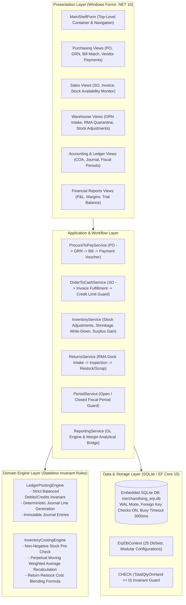
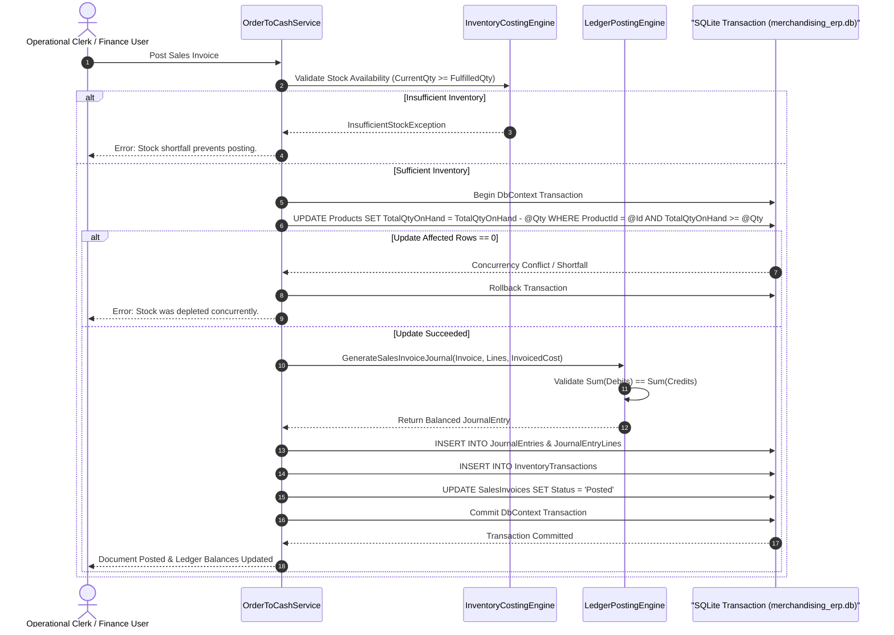

# MVP ERP Accounting System for Small-to-Mid Scale Merchandising Businesses

*   **Author:** Max Sainz
*   **Status:** Living Specification (Implemented & Reconciled)
*   **Date:** 2026-11-21

---

## Overview

Small-to-mid scale merchandising businesses (including wholesale distributors, import-to-retail merchants, and packaged goods suppliers) face inventory discrepancies, margin distortions, unrecorded shrinkage, and delayed financial closes. In typical setups, physical warehouse operations (receiving, picking, packing, shipping, and handling returns) happen in spreadsheets or standalone warehouse software disconnected from the General Ledger. Bookkeepers record summary journal entries days or weeks later based on supplier bills and bank statements, preventing real-time visibility into stock availability and product margins.

This system provides a document-driven, unified Enterprise Resource Planning (ERP) accounting architecture where warehouse operations and financial ledgers operate as a single system. Every operational transaction—receiving inventory, fulfilling sales orders, processing customer returns, and settling invoices—posts balanced double-entry accounting records in real time.

---

## The Problem

Operating inventory movements independently of the financial ledger causes four critical points of failure:

1. **Phantom Inventory and Margin Distortions**: When sales systems lack real-time stock valuation or allow negative inventory, items are sold without an accurate Cost of Goods Sold (COGS). Financial reports show artificial profit spikes, followed by substantial write-downs at month-end.
2. **Operational-to-Financial Disconnect (GRNI Lag)**: When goods arrive at the loading dock, warehouse staff need stock available immediately for sales fulfillment. However, vendor invoices frequently arrive weeks later with unexpected price adjustments or separate freight charges. Without a formal Goods Received Not Invoiced (GRNI) clearing mechanism, businesses either delay receiving (stalling sales) or fail to accrue liabilities accurately.
3. **Uncontrolled Returns Processing**: Customer returns often bypass quality control, putting damaged or opened goods back into active stock, or granting direct cash refunds without proper accounting verification, creating leakage and stock inaccuracy.
4. **Historical Restatements from Backdated Edits**: Standard bookkeeping software allows users to retroactively edit past transactions, which silently alters historical Trial Balances, invalidates previously closed accounting periods, and complicates tax compliance and audits.

The solution is a constraint-enforcing, document-driven financial system enforcing strict non-negative inventory balances, perpetual moving average costing, forward-only variance expensing, and append-only ledger entries where statutory posting dates are locked to open financial periods.

---

## Goals

* **Real-Time Balanced Financial Postings**: Generate balanced, double-entry General Ledger journal entries automatically whenever an operational document (Goods Receipt Note, Supplier Bill, Sales Invoice, Customer Return, Payment Voucher) is committed.
* **Non-Negative Inventory Enforcement**: Enforce validation that blocks generation or posting of sales invoices when physical on-hand stock is insufficient, preventing negative inventory and undefined unit costing.
* **Perpetual Moving Weighted Average Costing**: Continuously update unit valuation and inventory asset balances upon each Goods Receipt and restocked customer return, maintaining accurate inventory asset and COGS calculations without periodic manual count reconciliations.
* **Locked Closed Periods with Event Date Metadata**: Ensure the statutory General Ledger posting date (`PostingDate`) strictly maps to an open accounting period, preventing retroactive edits to closed periods. Preserve physical event timing as informational metadata (`OperationalEventDate`) on operational documents.
* **Three-Way Matching via GRNI Clearing**: Value stock receipts at purchase order prices against `2100 GRNI`, and route supplier bill price differences and inbound freight directly to `5100 Purchase Price Variance` and `5200 Inbound Freight Variance` in the current open period.
* **Controlled Two-Stage Customer Returns**: Direct customer returns into operational quarantine without initial financial impact, generating credit memos against Accounts Receivable and restocking/scrapping journal entries only after physical inspection.
* **Core Financial and Operational Reporting**: Deliver on-demand standard financial statements (Balance Sheet, Income Statement / P&L, Trial Balance) alongside operational reports (AR/AP Aging, Inventory Valuation, and Managerial Product Profitability).

---

## Non-Goals

* **Multi-Station / Networked Multi-User Operations**: The MVP is strictly restricted to a single dedicated PC workstation running as a standalone desktop process (or sequential operator handoffs on a single physical host). Multi-station concurrent operations across physical desks, shared network drives (SMB), or client-server databases are explicit non-goals for Day-1 MVP.
* **Manufacturing and Production (BOM/WIP)**: No assembly orders, bill of materials, work-in-progress tracking, or labor overhead allocation.
* **Multi-Warehouse and Multi-Bin Routing**: No multi-site inventory transfers, in-transit stock routing, or bin/aisle-level warehouse management.
* **Multi-Currency and Foreign Exchange**: No foreign exchange gain/loss calculations, revaluations, or multi-currency bank accounts (all international purchases must be recorded in the local base currency using landed conversion amounts).
* **Variable / Catch-Weight Units**: No fractional or weight-variable conversion ratios; inventory tracking is strictly anchored to atomic integer Base Units with integer packaging multipliers.
* **Countertop Cash Refunds**: No point-of-sale cash payouts for customer returns without managerial authorization and accounts payable disbursement vouchers.
* **Retroactive Inventory Revaluation**: No restatement of past inventory cost layers or retroactive recalculation of closed period COGS.
* **Automated Direct Bank Feeds**: No direct open-banking API integration or automated transaction parsing; bank reconciliation uses imported statements and manual match verification.

---

## Open Questions & Formal Resolutions

* **Open Question 1: Handling Partial Goods Receipts**:
  * *Resolution*: When a vendor delivers a partial shipment and cancels the remainder, the Purchase Order transitions to `Closed - Short`. Unfulfilled purchase order quantities are released from committed orders without generating a General Ledger entry.
* **Open Question 2: Aging and Disputed GRNI Clearing Balances**:
  * *Resolution*: Goods Received Not Invoiced (GRNI) balances remaining past 30 days are surfaced on an aging inquiry report. If a supplier invoice will never arrive (e.g., vendor concession, supplier dissolution, or resolved billing dispute), an authorized financial manager creates an approved `GRNIAdjustment` document that clears the accrual balance against `5100 Purchase Price Variance`.

---

## Critical User Journeys (CUJs)

### CUJ 1: Inbound Procurement and Dock Receiving
* **Given**: An approved Purchase Order exists for 100 units of SKU-A at $10.00/unit with supplier terms net-30.
* **When**: The warehouse clerk receives the delivery and confirms physical receipt via a Goods Receipt Note (GRN).
* **Then**: On-hand inventory increases by 100 units; the system posts Debit `1300 Merchandise Inventory` $1,000.00 and Credit `2100 GRNI` $1,000.00; moving average cost updates; and units immediately become available for sales orders.

### CUJ 2: Outbound Sales Fulfillment with Stock Guard
* **Given**: SKU-A has 50 units on hand at a moving average cost of $10.00/unit. A customer orders 60 units.
* **When**: A sales representative attempts to post a Sales Invoice for 60 units.
* **Then**: The system raises a validation block indicating insufficient stock (shortfall of 10 units); the document cannot post; on-hand stock and ledger accounts remain unchanged until stock is received or the order quantity is reduced to 50 units. When an order is within stock limits, posting the Sales Invoice decrements stock, records COGS, and recognizes revenue atomically.

### CUJ 3: Customer Return with Quarantine Inspection
* **Given**: A customer returns 10 units of SKU-A originally purchased at $15.00/unit (original unit cost $10.00/unit).
* **When**: The warehouse receives the items under a Customer Return document into quarantine and conducts inspection, determining 8 units are undamaged (restockable) and 2 units are damaged (scrap).
* **Then**: The clerk records inspection dispositions; finance generates a Credit Note for $150.00 (`4100 Sales Returns & Allowances` Debit $150.00, `1200 Accounts Receivable` Credit $150.00, establishing a customer credit balance on their AR subledger); 8 restocked units return to `1300 Merchandise Inventory` (Debit $80.00) and update the product's moving average cost, 2 units post to `5300 Inventory Shrinkage & Damaged Stock Expense` (Debit $20.00), and `5000 Cost of Goods Sold` is credited $100.00. If the customer requests a cash refund, a Payment Voucher debits `1200 Accounts Receivable` $150.00 and credits `1020 Operating Bank Account` $150.00.

---

## Technical Plan (Architecture)

### 1. System Architecture Overview

The application enforces a layered architecture within a single project, organized into Presentation, Service, Domain, and Persistence namespaces. The client targets .NET 10.0 Windows Forms on Windows x64 with an embedded SQLite relational store managed via Entity Framework Core 10.



---

### 2. Component Responsibilities

1. **Presentation Layer (`UI/`)**:
   - `MainShellForm`: Top-level window hosting task navigation (Purchasing, Sales, Inventory, Accounting, Reporting) and status strip displaying active database connectivity and open fiscal period.
   - Form-based document data-entry screens with reactive stock checks, input validation, and real-time document status indicators (`Draft`, `Posted`, `Settled`, `Cancelled`).
2. **Application & Workflow Services (`Services/`)**:
   - `ProcureToPayService`: Orchestrates PO creation, GRN dock intake receiving, Supplier Bill 3-way matching with variance expensing, Payment Voucher disbursements, stale GRNI accrual clearing (`ClearStaleGRNI` clearing unbilled receipts to `5100 PPV`), and PO short closure (`ClosePurchaseOrderShort`).
   - `OrderToCashService`: Orchestrates Sales Orders with credit limit enforcement (`CreditLimitExceededException`), Sales Invoice fulfillment (enforcing atomic conditional stock decrement), Customer Payment Receipts, Sales Order cancellation (`CancelSalesOrder`), and Sales Order short closure (`CloseSalesOrderShort`).
   - `InventoryService`:
     - `RecordInventoryAdjustment(documentNumber, reason, lines As IEnumerable(Of InventoryAdjustmentLine), adjustmentDate, notes, postingDate)`: Adjusts on-hand stock forward-only across multi-line batch counts.
     - For negative variances (shrinkage, damage, physical stocktake deficit): Decrements stock, debits `5300 Inventory Shrinkage & Damaged Stock Expense`, credits `1300 Merchandise Inventory` at moving average cost.
     - For positive variances (found stock, physical count surplus): Increments stock, debits `1300 Merchandise Inventory`, credits `5400 Stocktake Revaluation Variance` at current moving average cost.
   - `ReturnsService`: Manages customer return dock intake into quarantine (`ReceiveReturnToQuarantine`), inspection disposition recording (`ProcessReturnInspection` for restock vs. scrap), Credit Note posting against `1200 AR`, and customer refund disbursements (`DisburseCustomerRefund`).
   - `PeriodService`: Verifies that document `PostingDate` maps to an open accounting period before any journal posting is committed (`ValidatePostingDate`), manages month-end fiscal period closure (`CloseFiscalPeriod`), and resolves statutory posting dates for historical operational events (`ResolveStatutoryPostingDate`).
   - `ReportingService`: Executes read-only queries for standard accounting deliverables (Trial Balance, Balance Sheet, Income Statement / P&L, AR/AP Aging), managerial landed margin calculations (`GetProductProfitabilityBridge`), inventory stock valuation (`GetInventoryValuationReport`), and 30-day unbilled GRNI aging (`GetGrniAgingReport`).
3. **Domain Engine (`Domain/`)**:
   - `LedgerPostingEngine`: Stateless domain accounting engine. Validates that $\sum \text{Debits} == \sum \text{Credits}$ to 4 decimal places before creating journal entities. Emits balanced `JournalEntry` and `JournalEntryLine` instances.
   - `InventoryCostingEngine`: Pure calculation engine. Computes moving weighted average costs for purchase intake and restocked returns:
     $$\text{Purchase Inbound Cost} = \frac{(\text{Current Qty} \times \text{Current Unit Cost}) + (\text{Received Qty} \times \text{PO Unit Price})}{\text{Current Qty} + \text{Received Qty}}$$
     $$\text{Restock Return Cost} = \frac{(\text{Current Qty} \times \text{Current Unit Cost}) + (\text{Restocked Qty} \times \text{Original Invoice Unit Cost})}{\text{Current Qty} + \text{Restocked Qty}}$$
4. **Data Access & Persistence (`Data/`)**:
   - `ErpDbContext`: Entity Framework Core 10 `DbContext` managing SQLite connection lifecycle, schema migrations, entity mapping, change tracking, and atomic transactional Unit-of-Work commits.
   - Database configured with Write-Ahead Logging (`PRAGMA journal_mode=WAL;`), synchronous normal (`PRAGMA synchronous=NORMAL;`), foreign key constraints (`PRAGMA foreign_keys=ON;`), and busy timeout (`PRAGMA busy_timeout=3000;`).
   - Declarative database check constraint: `CHECK (TotalQtyOnHand >= 0)` on table `Products`.

---

### 3. Streamlined Relational Schema Design (25 Core Tables)

The relational schema is consolidated into 25 normalized tables, mapped through modular Entity Framework Core configurations (`Data/Configurations/*.vb`):

| Domain Area | Table Name | Columns & Constraints | Description |
| :--- | :--- | :--- | :--- |
| **General Ledger** | `Accounts` | `AccountId` (PK), `Code` (VARCHAR(10), UNIQUE), `Name` (VARCHAR(100)), `AccountType` (INT: Asset, Liability, Equity, Revenue, Expense), `IsActive` (BIT) | Standard Chart of Accounts (COA: 1010–5500). |
| | `AccountingPeriods` | `PeriodId` (PK), `FiscalYear` (INT), `PeriodNumber` (INT), `StartDate` (DATETIME), `EndDate` (DATETIME), `IsClosed` (BIT), `ClosedAtUtc` (DATETIME NULLABLE) | Monthly accounting periods. Sealed once closed. |
| | `JournalEntries` | `EntryId` (PK), `SourceDocType` (VARCHAR(30)), `SourceDocId` (INT), `PostingDate` (DATETIME), `OperationalEventDate` (DATETIME), `PeriodId` (FK), `Description` (VARCHAR(255)), `CreatedBy` (VARCHAR(50)) | Immutable financial transaction header. |
| | `JournalEntryLines` | `LineId` (PK), `EntryId` (FK), `AccountId` (FK), `DebitAmount` (DECIMAL(18,4)), `CreditAmount` (DECIMAL(18,4)), `LineMemo` (VARCHAR(255)) | Debit and credit distributions. |
| **Inventory** | `Products` | `ProductId` (PK), `SKU` (VARCHAR(50), UNIQUE), `Name` (VARCHAR(150)), `BaseUnitName` (VARCHAR(20)), `PackUnitName` (VARCHAR(20) NULLABLE), `PackMultiplier` (INT DEFAULT 1), `CurrentUnitCost` (DECIMAL(18,4)), `TotalQtyOnHand` (INT, `CHECK(TotalQtyOnHand >= 0)`), `AllocatedQty` (INT DEFAULT 0), `QuarantineQty` (INT DEFAULT 0), `IsActive` (BIT) | Products catalog with stock balances and packaging multipliers. |
| | `InventoryTransactions` | `TransactionId` (PK), `ProductId` (FK), `SourceDocType` (VARCHAR(30)), `SourceDocId` (INT), `OperationalEventDate` (DATETIME), `PostingDate` (DATETIME), `QtyChange` (INT), `UnitCost` (DECIMAL(18,4)), `RunningQty` (INT), `RunningUnitCost` (DECIMAL(18,4)) | Append-only inventory transaction audit ledger. |
| | `InventoryAdjustments` | `AdjustmentId` (PK), `DocumentNumber` (VARCHAR(30), UNIQUE), `AdjustmentDate` (DATETIME), `PostingDate` (DATETIME), `ReasonCode` (VARCHAR(50)), `Status` (VARCHAR(20)) | Physical stock counts, write-downs, and shrinkage. |
| | `InventoryAdjustmentLines` | `AdjustmentLineId` (PK), `AdjustmentId` (FK), `ProductId` (FK), `QtyChange` (INT), `UnitCost` (DECIMAL(18,4)), `TargetAccountId` (FK: 5300 or 5400), `Notes` (VARCHAR(255)) | Line adjustments for physical inventory counts. |
| **Procurement** | `Vendors` | `VendorId` (PK), `Code` (VARCHAR(20), UNIQUE), `Name` (VARCHAR(150)), `PaymentTermsDays` (INT), `CurrentPayableBalance` (DECIMAL(18,4)) | Supplier profiles and trade payable totals. |
| | `PurchaseOrders` | `POId` (PK), `VendorId` (FK), `DocumentNumber` (VARCHAR(30), UNIQUE), `Status` (VARCHAR(20)), `OrderDate` (DATETIME), `TotalAmount` (DECIMAL(18,4)) | Inbound purchase orders. |
| | `POLines` | `POLineId` (PK), `POId` (FK), `ProductId` (FK), `OrderedQty` (INT), `UnitPrice` (DECIMAL(18,4)) | Line items on purchase orders. |
| | `GoodsReceiptNotes` | `GRNId` (PK), `POId` (FK), `DocumentNumber` (VARCHAR(30), UNIQUE), `ReceiptDate` (DATETIME), `PostingDate` (DATETIME), `Status` (VARCHAR(20)) | Physical warehouse dock receiving vouchers. |
| | `GRNLines` | `GRNLineId` (PK), `GRNId` (FK), `POLineId` (FK), `ProductId` (FK), `ReceivedQty` (INT), `POUnitPrice` (DECIMAL(18,4)) | Received quantities valued at PO unit price. |
| | `SupplierBills` | `BillId` (PK), `VendorId` (FK), `DocumentNumber` (VARCHAR(30), UNIQUE), `BillDate` (DATETIME), `PostingDate` (DATETIME), `DueDate` (DATETIME), `TotalAmount` (DECIMAL(18,4)), `Status` (VARCHAR(20)) | Invoiced supplier claims against open GRNs. |
| | `BillLines` | `BillLineId` (PK), `BillId` (FK), `GRNLineId` (FK NULLABLE), `ProductId` (FK NULLABLE), `BilledQty` (INT), `BilledUnitPrice` (DECIMAL(18,4)), `LineTotal` (DECIMAL(18,4)), `FreightAmount` (DECIMAL(18,4)), `AccountId` (FK NULLABLE) | Billed merchandise and standalone carrier freight lines. |
| | `PaymentVouchers` | `VoucherId` (PK), `VoucherType` (VARCHAR(20)), `VendorId` (FK NULLABLE), `CustomerId` (FK NULLABLE), `TargetDocId` (INT), `VoucherNumber` (VARCHAR(30), UNIQUE), `PaymentDate` (DATETIME), `PostingDate` (DATETIME), `DisbursedAmount` (DECIMAL(18,4)), `BankAccountId` (FK: Accounts.AccountId) | Cash disbursements for AP settlements & customer refunds. |
| | `GRNIAdjustments` | `AdjustmentId` (PK), `DocumentNumber` (VARCHAR(30), UNIQUE), `GoodsReceiptLineId` (FK), `AdjustmentDate` (DATETIME), `PostingDate` (DATETIME), `ClearedQty` (INT), `ClearedAmount` (DECIMAL(18,4)), `Reason` (VARCHAR(255)), `Status` (VARCHAR(20)), `CreatedAt` (DATETIME) | Append-only unbilled GRNI clearing accrual write-offs posting Dr 2100 / Cr 5100. |
| **Sales & AR** | `Customers` | `CustomerId` (PK), `Code` (VARCHAR(20), UNIQUE), `Name` (VARCHAR(150)), `CreditLimit` (DECIMAL(18,4)), `CurrentARBalance` (DECIMAL(18,4)) | Customer profiles and trade receivable balances. |
| | `SalesOrders` | `SOId` (PK), `CustomerId` (FK), `DocumentNumber` (VARCHAR(30), UNIQUE), `OrderDate` (DATETIME), `Status` (VARCHAR(20)) | Commercial customer order commitments. |
| | `SOLines` | `SOLineId` (PK), `SOId` (FK), `ProductId` (FK), `OrderedQty` (INT), `UnitPrice` (DECIMAL(18,4)) | Line items on sales orders. |
| | `SalesInvoices` | `InvoiceId` (PK), `SOId` (FK NULLABLE), `CustomerId` (FK), `DocumentNumber` (VARCHAR(30), UNIQUE), `InvoiceDate` (DATETIME), `PostingDate` (DATETIME), `DueDate` (DATETIME), `TotalAmount` (DECIMAL(18,4)), `Status` (VARCHAR(20)) | Combined sales billing and stock dispatch document. |
| | `SalesInvoiceLines` | `InvoiceLineId` (PK), `InvoiceId` (FK), `SOLineId` (FK NULLABLE), `ProductId` (FK), `FulfilledQty` (INT), `UnitPrice` (DECIMAL(18,4)), `InvoicedCOGSUnitCost` (DECIMAL(18,4)) | Line fulfillment tracking selling price and COGS unit cost. |
| | `PaymentReceipts` | `ReceiptId` (PK), `CustomerId` (FK), `InvoiceId` (FK NULLABLE), `ReceiptDate` (DATETIME), `PostingDate` (DATETIME), `AmountReceived` (DECIMAL(18,4)), `BankAccountId` (FK: Accounts.AccountId) | Customer payments clearing AR. |
| **Returns** | `CustomerReturns` | `ReturnId` (PK), `CustomerId` (FK), `OriginalInvoiceId` (FK), `DocumentNumber` (VARCHAR(30), UNIQUE), `ReturnDate` (DATETIME), `PostingDate` (DATETIME), `Status` (VARCHAR(20)) | Customer return voucher (quarantine intake and disposition). |
| | `CustomerReturnLines` | `ReturnLineId` (PK), `ReturnId` (FK), `ProductId` (FK), `ReturnedQty` (INT), `RestockQty` (INT), `ScrapQty` (INT), `OriginalUnitCost` (DECIMAL(18,4)), `SellingUnitPrice` (DECIMAL(18,4)), `DispositionStatus` (VARCHAR(20)) | Return inspection lines recording restock and scrap counts. |

#### 3.1 Modular Entity Framework Core 10 Configuration Topology
Rather than maintaining a monolithic OnModelCreating method, entity mappings are partitioned into domain-scoped configuration classes implementing `IEntityTypeConfiguration(Of T)` in `Data/Configurations/`:
* `GeneralLedgerConfigurations.vb`: Account, AccountingPeriod, JournalEntry, JournalEntryLine.
* `InventoryConfigurations.vb`: Product, InventoryTransaction, InventoryAdjustment, InventoryAdjustmentLine.
* `ProcurementConfigurations.vb`: Vendor, PurchaseOrder, POLine, GoodsReceiptNote, GRNLine, SupplierBill, BillLine, PaymentVoucher, GRNIAdjustment.
* `SalesConfigurations.vb`: Customer, SalesOrder, SOLine, SalesInvoice, SalesInvoiceLine, PaymentReceipt.
* `ReturnsConfigurations.vb`: CustomerReturn, CustomerReturnLine.

`ErpDbContext.OnModelCreating` registers all modular configurations dynamically via:
```vb
modelBuilder.ApplyConfigurationsFromAssembly(GetType(ErpDbContext).Assembly)
```

#### 3.2 Decoupled UserControl Architecture Standard
In accordance with GEMINI.md Rule 6.4, complex desktop modules and views are built using decoupled, self-contained `UserControl` components with dedicated ViewModels and visual designers. Reusable atomic controls include:
* `DoubleEntryDistributionGridControl`: Balanced debit/credit ledger distribution line presenter.
* `FiscalPeriodChipControl`: Real-time statutory open/closed period validation badge.
* `BalancedStatusBadgeControl`: Visual zero-sum variance indicator.

#### 3.3 Presentation ViewModels
Presentation state and grid data-binding logic are encapsulated within decoupled ViewModels:
* `LedgerViewModels.vb`: Journal entry lines, account balance display rows, and period selection state.
* `PurchasingViewModels.vb`: PO line items, 3-way matching rows with PPV/freight variance breakdown, and payment voucher allocation models.
* `ReportingViewModels.vb`: Trial balance rows, P&L hierarchy models, and product gross margin summaries.
* `SalesViewModels.vb`: Sales order line tracking, invoice dispatch rows, and stock availability monitoring view models.
* `WarehouseViewModels.vb`: Dock intake rows, RMA quarantine inspection items, and stock adjustment lines.

#### 3.4 Financial Protection Dialogs
Modal operational dialogs provide protective safeguards for sensitive financial transactions:
* `FiscalPeriodForm.vb`: Guarded interface for fiscal month closure administration and period sealing.
* `DisburseVendorPaymentDialog.vb`: Dedicated disbursement dialog for selecting settled bills, choosing source bank accounts, and emitting Payment Vouchers.

---

### 4. Deterministic Ledger Posting Mechanics

Every document posting transaction executes an atomic batch mutation inside a serializable database transaction:



#### Master Chart of Accounts (COA)

| Code | Account Name | Type | Normal Balance | Description |
| :--- | :--- | :--- | :--- | :--- |
| `1010` | Cash on Hand | Asset | Debit | Physical cash register funds. |
| `1020` | Operating Bank Account | Asset | Debit | Primary operating checking/bank account. |
| `1200` | Accounts Receivable | Asset | Debit | Trade customer receivables and credit memo subledger balances. |
| `1300` | Merchandise Inventory | Asset | Debit | Valuated physical stock available for sale. |
| `2000` | Accounts Payable | Liability | Credit | Trade obligations owed to merchandise suppliers and freight carriers. |
| `2100` | Goods Received Not Invoiced (GRNI) | Liability | Credit | Interim clearing account for received inventory awaiting vendor bills. |
| `3000` | Retained Earnings | Equity | Credit | Accumulated prior period earnings. |
| `3010` | Owner's Capital | Equity | Credit | Initial capital contributions. |
| `4000` | Sales Revenue | Revenue | Credit | Invoiced sales income from customer deliveries. |
| `4100` | Sales Returns & Allowances | Revenue (Contra) | Debit | Gross customer returns and credit allowances. |
| `5000` | Cost of Goods Sold (COGS) | Expense | Debit | Direct inventory cost of goods dispatched to customers. |
| `5100` | Purchase Price Variance (PPV) | Expense | Debit/Credit | Discrepancies between PO price and Supplier Bill price. |
| `5200` | Inbound Freight Variance | Expense | Debit | Uncapitalized third-party or billed freight costs. |
| `5300` | Inventory Shrinkage & Damaged Stock | Expense | Debit | Write-offs for damaged customer returns and stock count deficits. |
| `5400` | Stocktake Revaluation Variance | Expense | Debit/Credit | Adjustments for physical warehouse stock count surpluses/deficits. |
| `5500` | Cash Rounding & Roundoff Variance | Expense | Debit/Credit | Fractional penny rounding differences ($\le \$0.02$). |

#### Journal Posting Table Matrix

| Operational Document | Debit Posting Account | Credit Posting Account | Valuation Basis |
| :--- | :--- | :--- | :--- |
| **Goods Receipt Note (GRN)** | `1300 Merchandise Inventory` | `2100 GRNI Clearing` | $\text{Received Qty} \times \text{PO Unit Price}$ |
| **Supplier Bill (At PO Price)** | `2100 GRNI Clearing` | `2000 Accounts Payable` | $\text{Billed Qty} \times \text{PO Unit Price}$ |
| **Supplier Bill (Price Variance)** | `5100 Purchase Price Variance` | `2000 Accounts Payable` | $(\text{Billed Price} - \text{PO Price}) \times \text{Billed Qty}$ |
| **Supplier Bill (Inbound Freight)** | `5200 Inbound Freight Variance` | `2000 Accounts Payable` | Direct invoiced freight line amount |
| **Vendor Payment Voucher** | `2000 Accounts Payable` | `1020 Operating Bank Account` | Settled payment amount |
| **Sales Invoice (Revenue)** | `1200 Accounts Receivable` | `4000 Sales Revenue` | $\text{Fulfilled Qty} \times \text{Selling Unit Price}$ |
| **Sales Invoice (COGS)** | `5000 Cost of Goods Sold` | `1300 Merchandise Inventory` | $\text{Fulfilled Qty} \times \text{Moving Avg Unit Cost}$ |
| **Customer Payment Receipt** | `1020 Operating Bank Account` | `1200 Accounts Receivable` | Cash/Check/Transfer received amount |
| **Customer Return (Quarantine Intake)** | *No Ledger Entry* | *No Ledger Entry* | Physical quarantine log only (`QuarantineQty`) |
| **Credit Note (Restocked Qty)** | `4100 Sales Returns & Allowances`<br/>`1300 Merchandise Inventory` | `1200 Accounts Receivable`<br/>`5000 Cost of Goods Sold` | Invoiced Selling Price<br/>$\text{Restocked Qty} \times \text{Original Invoice Cost}$ |
| **Credit Note (Scrapped Qty)** | `4100 Sales Returns & Allowances`<br/>`5300 Inventory Shrinkage` | `1200 Accounts Receivable`<br/>`5000 Cost of Goods Sold` | Invoiced Selling Price<br/>$\text{Scrapped Qty} \times \text{Original Invoice Cost}$ |
| **Customer Refund Disbursement** | `1200 Accounts Receivable` | `1020 Operating Bank Account` | Authorized bank refund clearing negative AR |
| **Inventory Shrinkage Write-Down** | `5300 Inventory Shrinkage` | `1300 Merchandise Inventory` | $\text{Adjusted Qty} \times \text{Current Unit Cost}$ |
| **Inventory Stocktake Surplus** | `1300 Merchandise Inventory` | `5400 Stocktake Variance` | $\text{Surplus Qty} \times \text{Current Unit Cost}$ |
| **GRNI Clearing Adjustment** | `2100 GRNI Clearing` | `5100 Purchase Price Variance` | $\text{Cleared Qty} \times \text{PO Unit Price}$ (Aging unbilled liability write-off) |
| **Reversing Journal Entry** | Opposite of Target Debit Account | Opposite of Target Credit Account | Strict append-only inversion of target journal lines to correct posting errors |

---

### 5. Concurrency, Locking & Precision Boundaries

1. **Transaction Serializability & Concurrency Control**:
   - Single-workstation desktop application executing on the UI thread message loop.
   - Persistence operations run inside `ErpDbContext` transactions (`BeginTransactionAsync`).
   - SQLite WAL mode configured with `PRAGMA busy_timeout = 3000;`. Custom semaphore queues are omitted.
   - Non-negative stock invariant enforced by declarative database check constraint `CHECK (TotalQtyOnHand >= 0)` and atomic conditional updates (`WHERE TotalQtyOnHand >= @Qty`).
2. **Computational Precision & Rounding**:
   - All unit costs, prices, journal entry debit/credit figures, and inventory values strictly utilize the .NET `Decimal` type (128-bit fixed-point representation).
   - Journal entry balancing enforces equality to 4 decimal places: `Math.Round(debitSum, 4) == Math.Round(creditSum, 4)`.
   - Any penny-rounding variance generated from fractional unit packaging conversions is routed to `5500 Cash Rounding & Roundoff Variance` if $|variance| \le 0.02$, or halts with a validation error if greater.
3. **Period Locking Guard**:
   - `PeriodService` validates `PostingDate` against `AccountingPeriods`.
   - The statutory posting date (`PostingDate`) must fall in an open period (`IsClosed = 0`). Closed periods are permanently immutable.
   - Operational events physically occurring in prior closed periods are assigned a `PostingDate` on the first open day of the current period, retaining `OperationalEventDate` as physical event metadata.

---

## Alternatives Considered

### Alternative 1: Periodic Inventory Accounting (vs. Perpetual Moving Average)
* **Pros**: Simple data model; requires zero real-time inventory tracking; purchase invoices debit a generic "Purchases" expense account without dock receiving controls.
* **Cons**: Leaves business management blind to intra-period gross margins and stock levels; cannot detect shrinkage or damage until year-end physical counts; prevents sales representatives from verifying real-time stock availability.
* **Reason for Rejection**: Small-to-mid scale merchandising operations cannot maintain viable order fulfillment or control cash flow without knowing real-time inventory availability and per-order margins.

### Alternative 2: First-In, First-Out (FIFO) Cost Layering (vs. Moving Weighted Average)
* **Pros**: Marginally closer alignment between physical item flow and cost flow under inflationary conditions.
* **Cons**: Requires persisting individual cost queues for every purchase receipt; creates significant schema and query complexity when handling customer returns; increases database transaction overhead during order dispatch.
* **Reason for Rejection**: For merchants selling standard packaged merchandise, the added complexity of maintaining sequential cost queues across returns and split dispatches does not justify the negligible valuation variance compared to Perpetual Moving Weighted Average.

### Alternative 3: Permitting Negative Inventory Balances with Retroactive Cost Smoothing
* **Pros**: Frontline sales clerks are never blocked from dispatching orders when physical goods are present in the warehouse but paperwork has not been entered.
* **Cons**: Creates severe mathematical anomalies, such as division by zero or negative unit valuations, distorting inventory balances; requires complex retroactive recalculation engines that modify historical Cost of Goods Sold and invalidate previously closed Trial Balances.
* **Reason for Rejection**: Negative inventory compromises the fundamental integrity of double-entry accounting. Operational receiving delays must be addressed via fast-track intake workflows, not by corrupting financial ledgers.

### Alternative 4: Retroactive Landed Cost Capitalization to Remaining Stock
* **Pros**: Reconciles the statutory unit cost of the remaining on-hand stock with late-arriving freight or customs invoices.
* **Cons**: If 70% of a shipment was already sold before the freight invoice arrives, loading 100% of the freight charge onto the remaining 30% of inventory units distorts their asset value. Alternatively, retroactively restating the COGS for previously sold items modifies past closed periods, invalidating filed financial reports.
* **Reason for Rejection**: Forward-only expensing of late freight to `5200 Inbound Freight Variance` preserves historical ledger integrity, while the analytical Product Profitability Report provides the necessary SKU-level landed margin visibility.

### Alternative 5: Single-Stage Direct Restock Returns
* **Pros**: Faster processing; requires only one document (Credit Note) to simultaneously refund the customer and restock inventory.
* **Cons**: Unchecked items are returned directly to active inventory, resulting in broken, damaged, or expired stock being shipped to subsequent customers; obscures physical inspection accountability.
* **Reason for Rejection**: Separating physical receipt into operational quarantine from financial Credit Note generation prevents damaged stock contamination and ensures scrapped units are expensed accurately to `5300 Inventory Shrinkage`.

### Alternative 6: Client-Server RDBMS (PostgreSQL / Microsoft SQL Server) for MVP
* **Pros**: Built-in multi-user network concurrency, server-side stored procedures, and row-level locking.
* **Cons**: Requires external database installation, user administration, credential management, network firewall setup, and server maintenance, increasing deployment friction for a desktop-centric MVP.
* **Reason for Rejection**: An embedded SQLite database running with Write-Ahead Logging (WAL) and atomic conditional updates provides zero-configuration deployment, low-latency sub-millisecond local read performance, and sufficient transactional capacity for single-workstation merchandising operations.

---

## Risks & Mitigations

| Risk / Failure Mode | Likelihood | Impact | Concrete Architectural Mitigation |
| :--- | :--- | :--- | :--- |
| **Client Power Loss During Document Commit** | Low | High | All multi-table updates (stock decrement, journal lines, document status) are wrapped in atomic EF Core SQLite transactions (`IDbTransaction`). SQLite WAL journaling ensures atomic rollback upon power restoration. |
| **Warehouse Dock Receiving Blockade** | Medium | High | Dock receiving is decoupled from supplier invoicing. Warehouse clerks post Goods Receipt Notes immediately at PO unit price, releasing stock for sales within $< 50\text{ ms}$ without waiting for the vendor bill. |
| **Supplier Invoice Latency (Stale GRNI Liability)** | High | Medium | An automated 30-day GRNI aging report alerts finance to unbilled shipments. Disputed or abandoned balances are formally written off to `5100 PPV` using an authorized `GRNIAdjustment` document. |
| **TOCTOU Concurrency Race Condition on Stock Fulfillment** | Medium | High | Database-level `CHECK (TotalQtyOnHand >= 0)` constraint combined with atomic conditional update (`UPDATE Products ... WHERE TotalQtyOnHand >= @Qty`) and affected-row verification guarantees physical stock cannot drop below zero. |
| **Quarantine Inspection Backlog** | Medium | Medium | Returns remain in non-valuated operational quarantine (`QuarantineQty`) with zero ledger impact until inspected. Scrapped units are expensed directly to `5300 Shrinkage`, while restocked units atomically update moving average cost. |
| **Late Operational Entries in Closed Fiscal Periods** | High | High | Closed periods are permanently immutable. The posting date (`PostingDate`) is automatically assigned to the first open day of the current period, while preserving historical occurrence time in `OperationalEventDate`. |
| **Multi-Machine SMB Network Share Corruption** | Low | Critical | MVP is strictly bounded to a single dedicated PC workstation in Non-Goals. SQLite database file resides on local storage (`Path.Combine(Application.StartupPath, "merchandising_erp.db")`). |

---

## Non-Functional Requirements

### Security & Integrity
* **Append-Only Application Ledgers**: `JournalEntries` and `JournalEntryLines` tables have no `UPDATE` or `DELETE` application pathways. Corrections require generating an explicit reversing journal entry linked to the original document.
* **Strict Foreign Key Enforcement**: SQLite foreign keys (`PRAGMA foreign_keys = ON;`) ensure zero orphaned line items or unlinked account distributions.

### Performance & Latency
* **Document Commit Latency**: All transactional postings (inventory deduction, moving average recalculation, and journal balancing) must complete in $< 50\text{ ms}$ under SQLite WAL mode.
* **Reporting Query Performance**: Trial Balance and Stock Valuation queries must execute in $< 200\text{ ms}$ for catalogs up to 10,000 SKUs and 100,000 journal lines.

### Rollout & Reliability
* **Single-File Portability & Backup**: The entire state resides in `merchandising_erp.db`, enabling automated atomic backups using SQLite Online Backup APIs or copy-on-shutdown mechanisms.

---

## Detailed Implementation Plan

### Target Files to Create/Modify/Delete

```
+---------------------------------------------------------------------------------------------------------+
|                                  TARGET FILE MANIFEST (PHASED EXECUTION)                                |
+---------------------------------------------------------------------------------------------------------+
| SOLUTION & CONFIGURATION:                                                                               |
| - Merchandising_Accounting_App.slnx                                                    [Modify/Relocate]|
| - Merchandising_Accounting_App/Merchandising_Accounting_App.vbproj                      [Modify]        |
| - Merchandising_Accounting_App/My Project/Application.myapp                            [Modify]        |
| - Merchandising_Accounting_App/ApplicationEvents.vb                                     [Modify]        |
| - Merchandising_Accounting_App/Form1.vb, Form1.Designer.vb, Form1.resx                 [Delete]        |
| - Merchandising_Accounting_App.Tests/Merchandising_Accounting_App.Tests.vbproj         [Create]        |
| - Merchandising_Accounting_App.PreviewTool/Merchandising_Accounting_App.PreviewTool.vbproj[Create]     |
| - Merchandising_Accounting_App.PreviewTool/Program.vb                                   [Create]        |
| - preview_ui.ps1                                                                        [Create]        |
| - tools/check_workspace_hygiene.ps1                                                     [Create]        |
| - tools/check_stop_hygiene.ps1                                                          [Create]        |
| - .agents/hooks.json                                                                    [Create]        |
+---------------------------------------------------------------------------------------------------------+
| DOMAIN LAYER (ENTITIES, ENUMS, ENGINES):                                                                |
| - Merchandising_Accounting_App/Domain/Enums.vb                                         [Create]        |
| - Merchandising_Accounting_App/Domain/Exceptions.vb                                     [Create]        |
| - Merchandising_Accounting_App/Domain/Models/GeneralLedgerEntities.vb                  [Create]        |
| - Merchandising_Accounting_App/Domain/Models/InventoryEntities.vb                      [Create]        |
| - Merchandising_Accounting_App/Domain/Models/ProcurementEntities.vb                    [Create]        |
| - Merchandising_Accounting_App/Domain/Models/SalesEntities.vb                          [Create]        |
| - Merchandising_Accounting_App/Domain/Models/ReturnsEntities.vb                        [Create]        |
| - Merchandising_Accounting_App/Domain/Engines/InventoryCostingEngine.vb                [Create]        |
| - Merchandising_Accounting_App/Domain/Engines/LedgerPostingEngine.vb                   [Create]        |
+---------------------------------------------------------------------------------------------------------+
| PERSISTENCE LAYER (EF CORE 10, CONFIGURATIONS & REPOSITORIES):                                          |
| - Merchandising_Accounting_App/Data/ErpDbContext.vb                                    [Create]        |
| - Merchandising_Accounting_App/Data/DatabaseInitializer.vb                             [Create]        |
| - Merchandising_Accounting_App/Data/Configurations/GeneralLedgerConfigurations.vb      [Create]        |
| - Merchandising_Accounting_App/Data/Configurations/InventoryConfigurations.vb          [Create]        |
| - Merchandising_Accounting_App/Data/Configurations/ProcurementConfigurations.vb        [Create]        |
| - Merchandising_Accounting_App/Data/Configurations/ReturnsConfigurations.vb            [Create]        |
| - Merchandising_Accounting_App/Data/Configurations/SalesConfigurations.vb              [Create]        |
| - Merchandising_Accounting_App/Data/Repositories/AccountRepository.vb                  [Create]        |
| - Merchandising_Accounting_App/Data/Repositories/ProductRepository.vb                  [Create]        |
| - Merchandising_Accounting_App/Data/Repositories/LedgerRepository.vb                   [Create]        |
| - Merchandising_Accounting_App/Data/Repositories/DocumentRepository.vb                 [Create]        |
| - Merchandising_Accounting_App/Data/Repositories/AccountingPeriodRepository.vb         [Create]        |
+---------------------------------------------------------------------------------------------------------+
| APPLICATION SERVICES LAYER:                                                                             |
| - Merchandising_Accounting_App/Services/PeriodService.vb                               [Create]        |
| - Merchandising_Accounting_App/Services/ProcureToPayService.vb                         [Create]        |
| - Merchandising_Accounting_App/Services/OrderToCashService.vb                          [Create]        |
| - Merchandising_Accounting_App/Services/InventoryService.vb                            [Create]        |
| - Merchandising_Accounting_App/Services/ReturnsService.vb                              [Create]        |
| - Merchandising_Accounting_App/Services/ReportingService.vb                            [Create]        |
+---------------------------------------------------------------------------------------------------------+
| PRESENTATION LAYER (WINDOWS FORMS, CONTROLS, VIEWMODELS & DESIGNERS):                                   |
| - Merchandising_Accounting_App/UI/MainShellForm.vb                                      [Create]        |
| - Merchandising_Accounting_App/UI/MainShellForm.Designer.vb                             [Create]        |
| - Merchandising_Accounting_App/UI/Controls/BalancedStatusBadgeControl.vb                [Create]        |
| - Merchandising_Accounting_App/UI/Controls/BalancedStatusBadgeControl.Designer.vb       [Create]        |
| - Merchandising_Accounting_App/UI/Controls/DoubleEntryDistributionGridControl.vb        [Create]        |
| - Merchandising_Accounting_App/UI/Controls/DoubleEntryDistributionGridControl.Designer.vb[Create]      |
| - Merchandising_Accounting_App/UI/Controls/FiscalPeriodChipControl.vb                  [Create]        |
| - Merchandising_Accounting_App/UI/Controls/FiscalPeriodChipControl.Designer.vb         [Create]        |
| - Merchandising_Accounting_App/UI/Purchasing/PurchasingDashboardForm.vb                 [Create]        |
| - Merchandising_Accounting_App/UI/Purchasing/PurchasingDashboardForm.Designer.vb        [Create]        |
| - Merchandising_Accounting_App/UI/Purchasing/DisburseVendorPaymentDialog.vb             [Create]        |
| - Merchandising_Accounting_App/UI/Purchasing/DisburseVendorPaymentDialog.Designer.vb    [Create]        |
| - Merchandising_Accounting_App/UI/Purchasing/PurchasingViewModels.vb                   [Create]        |
| - Merchandising_Accounting_App/UI/Sales/SalesDashboardForm.vb                           [Create]        |
| - Merchandising_Accounting_App/UI/Sales/SalesDashboardForm.Designer.vb                  [Create]        |
| - Merchandising_Accounting_App/UI/Sales/SalesViewModels.vb                              [Create]        |
| - Merchandising_Accounting_App/UI/Warehouse/WarehouseIntakeForm.vb                      [Create]        |
| - Merchandising_Accounting_App/UI/Warehouse/WarehouseIntakeForm.Designer.vb             [Create]        |
| - Merchandising_Accounting_App/UI/Warehouse/WarehouseViewModels.vb                      [Create]        |
| - Merchandising_Accounting_App/UI/Accounting/LedgerDashboardForm.vb                     [Create]        |
| - Merchandising_Accounting_App/UI/Accounting/LedgerDashboardForm.Designer.vb            [Create]        |
| - Merchandising_Accounting_App/UI/Accounting/FiscalPeriodForm.vb                         [Create]        |
| - Merchandising_Accounting_App/UI/Accounting/FiscalPeriodForm.Designer.vb               [Create]        |
| - Merchandising_Accounting_App/UI/Accounting/LedgerViewModels.vb                         [Create]        |
| - Merchandising_Accounting_App/UI/Reporting/FinancialReportsForm.vb                     [Create]        |
| - Merchandising_Accounting_App/UI/Reporting/FinancialReportsForm.Designer.vb            [Create]        |
| - Merchandising_Accounting_App/UI/Reporting/ReportingViewModels.vb                     [Create]        |
+---------------------------------------------------------------------------------------------------------+
| AUTOMATED TEST SUITE & FIXTURES:                                                                        |
| - Merchandising_Accounting_App.Tests/MSTestSettings.vb                                  [Create]        |
| - Merchandising_Accounting_App.Tests/Infrastructure/TestDatabaseFixture.vb             [Create]        |
| - Merchandising_Accounting_App.Tests/Infrastructure/PersistenceInfrastructureTests.vb   [Create]        |
| - Merchandising_Accounting_App.Tests/Domain/InventoryCostingEngineTests.vb             [Create]        |
| - Merchandising_Accounting_App.Tests/Domain/LedgerPostingEngineTests.vb                [Create]        |
| - Merchandising_Accounting_App.Tests/Services/ProcureToPayServiceTests.vb              [Create]        |
| - Merchandising_Accounting_App.Tests/Services/OrderToCashServiceTests.vb               [Create]        |
| - Merchandising_Accounting_App.Tests/Services/InventoryServiceTests.vb                 [Create]        |
| - Merchandising_Accounting_App.Tests/Services/ReturnsServiceTests.vb                   [Create]        |
| - Merchandising_Accounting_App.Tests/Services/PeriodServiceTests.vb                    [Create]        |
| - Merchandising_Accounting_App.Tests/Services/ReportingServiceTests.vb                 [Create]        |
| - Merchandising_Accounting_App.Tests/Services/SalesDashboardSettlementTests.vb         [Create]        |
| - Merchandising_Accounting_App.Tests/Integration/EndToEndCUJTests.vb                   [Create]        |
| - Merchandising_Accounting_App.Tests/FormInstantiationTests.vb                         [Create]        |
| - Merchandising_Accounting_App.Tests/BrandingAndBrandingStringsTests.vb                 [Create]        |
| - Merchandising_Accounting_App.Tests/DecimalCurrencyFormattingTests.vb                 [Create]        |
| - Merchandising_Accounting_App.Tests/WorkspaceHygieneTests.vb                          [Create]        |
+---------------------------------------------------------------------------------------------------------+
```

---

### Phased Execution Strategy

#### Phase 1: Project Hardening, Solution Topology & Startup Configuration
*   **Target Files**:
    *   `Merchandising_Accounting_App.slnx` (Relocate to root and bind projects)
    *   `Merchandising_Accounting_App/Merchandising_Accounting_App.vbproj` (Modify)
    *   `Merchandising_Accounting_App/My Project/Application.myapp` (Modify)
    *   `Merchandising_Accounting_App/ApplicationEvents.vb` (Modify)
    *   `Merchandising_Accounting_App/Form1.vb`, `Form1.Designer.vb`, `Form1.resx` (Delete)
    *   `Merchandising_Accounting_App.Tests/Merchandising_Accounting_App.Tests.vbproj` (Create)
    *   `Merchandising_Accounting_App.PreviewTool/Merchandising_Accounting_App.PreviewTool.vbproj` (Create)
    *   `Merchandising_Accounting_App.PreviewTool/Program.vb` (Create)
    *   `preview_ui.ps1` (Create)
    *   `tools/check_workspace_hygiene.ps1` (Create)
    *   `tools/check_stop_hygiene.ps1` (Create)
    *   `.agents/hooks.json` (Create)
*   **Actionable Steps**:
    1. Relocate `Merchandising_Accounting_App.slnx` from subfolder to repository root `c:\Users\maxsa\Documents\Project_Accounting\Merchandising_Accounting_App.slnx`.
    2. Configure `Merchandising_Accounting_App.vbproj`:
       - Enable strict typing: `<OptionStrict>On</OptionStrict>`, `<OptionExplicit>On</OptionExplicit>`, `<OptionCompare>Binary</OptionCompare>`.
       - Enforce compiler warnings as errors: `<TreatWarningsAsErrors>true</TreatWarningsAsErrors>`.
       - Add NuGet package: `Microsoft.EntityFrameworkCore.Sqlite` (Version `10.0.0`).
       - Exclude obsolete template files.
    3. Update `Application.myapp` replacing `<MainForm>Form1</MainForm>` with `<MainForm>MainShellForm</MainForm>`.
    4. Delete `Form1.vb`, `Form1.Designer.vb`, and `Form1.resx`.
    5. Create test project `Merchandising_Accounting_App.Tests.vbproj` targeting `net10.0`, referencing `Microsoft.NET.Test.Sdk`, `MSTest.TestAdapter`, `MSTest.TestFramework`, `Moq`, and project reference `..\Merchandising_Accounting_App\Merchandising_Accounting_App.vbproj`.
    6. Register both projects in `Merchandising_Accounting_App.slnx`.
    7. Build headless automated UI preview engine (`Merchandising_Accounting_App.PreviewTool/` and `preview_ui.ps1`) to render and visually inspect application forms and controls offscreen across dual resolutions (1280×720 restored and 1920×1080 maximized).
    8. Establish workspace hygiene and governance tooling (`tools/check_workspace_hygiene.ps1`, `tools/check_stop_hygiene.ps1`, and `.agents/hooks.json`) ensuring repository cleanliness, rule file length invariant, active plan archival, and living specification manifest parity.
*   **Verification Gate (Checkpoint 1)**:
    ```powershell
    dotnet build Merchandising_Accounting_App.slnx -c Release
    ```
    *Must compile with 0 errors and 0 warnings.*

#### Phase 2: Domain Entities, Enums, Exceptions & Invariant Computation Engines
*   **Target Files**:
    *   `Merchandising_Accounting_App/Domain/Enums.vb` (Create)
    *   `Merchandising_Accounting_App/Domain/Exceptions.vb` (Create)
    *   `Merchandising_Accounting_App/Domain/Models/GeneralLedgerEntities.vb` (Create)
    *   `Merchandising_Accounting_App/Domain/Models/InventoryEntities.vb` (Create)
    *   `Merchandising_Accounting_App/Domain/Models/ProcurementEntities.vb` (Create)
    *   `Merchandising_Accounting_App/Domain/Models/SalesEntities.vb` (Create)
    *   `Merchandising_Accounting_App/Domain/Models/ReturnsEntities.vb` (Create)
    *   `Merchandising_Accounting_App/Domain/Engines/InventoryCostingEngine.vb` (Create)
    *   `Merchandising_Accounting_App/Domain/Engines/LedgerPostingEngine.vb` (Create)
    *   `Merchandising_Accounting_App.Tests/Domain/InventoryCostingEngineTests.vb` (Create)
    *   `Merchandising_Accounting_App.Tests/Domain/LedgerPostingEngineTests.vb` (Create)
*   **Actionable Steps**:
    1. Define domain enums: `AccountType`, `DocumentStatus` (`Draft`, `Posted`, `Settled`, `Cancelled`), `ReturnDisposition` (`Restock`, `Scrap`), `AdjustmentReason` (`Shrinkage`, `Damage`, `CountSurplus`, `CountDeficit`).
    2. Define business exceptions: `InsufficientStockException`, `UnbalancedJournalEntryException`, `ClosedPeriodPostingException`, `ThreeWayMatchException`, `CreditLimitExceededException`.
    3. Implement `InventoryCostingEngine` as pure functions:
       - `ValidateSufficientStock(currentQty As Integer, requiredQty As Integer) As Boolean`
       - `EnsureSufficientStock(currentQty As Integer, requiredQty As Integer, Optional productId As Integer = 0)`
       - `CalculateNewMovingAverageCost(currentQty, currentCost, receivedQty, poUnitPrice) As Decimal`
       - `CalculateRestockMovingAverageCost(currentQty, currentCost, restockedQty, originalInvoiceCost) As Decimal`
       - `ConvertPackagingToUnits(packQty As Integer, multiplier As Integer) As Integer`
       - `ConvertUnitsToPackaging(units As Integer, multiplier As Integer, ByRef remainderUnits As Integer) As Integer`
       - `CalculateInventoryValuation(qty As Integer, unitCost As Decimal) As Decimal`
    4. Implement `LedgerPostingEngine` as pure functions:
       - `IsBalanced(debits As Decimal, credits As Decimal) As Boolean` and `IsBalanced(lines As IEnumerable(Of JournalEntryLine)) As Boolean`
       - `ValidateJournalBalance(lines As IEnumerable(Of JournalEntryLine))` (Enforces $\sum \text{Debits} == \sum \text{Credits}$ to 4 decimal places).
       - `AllocatePennyRounding(lines As IList(Of JournalEntryLine), Optional roundingAccountId As Integer = AccountCodes.CashRoundingVariance) As Boolean`
       - `GenerateGRNJournal(grn As GoodsReceiptNote, lines As IEnumerable(Of GRNLine)) As JournalEntry`
       - `GenerateSupplierBillJournal(bill As SupplierBill, lines As IEnumerable(Of BillLine)) As JournalEntry`
       - `GenerateSalesInvoiceJournal(invoice As SalesInvoice, lines As IEnumerable(Of SalesInvoiceLine)) As JournalEntry`
       - `GenerateCreditNoteJournal(returnDoc As CustomerReturn, lines As IEnumerable(Of CustomerReturnLine)) As JournalEntry`
       - `GeneratePaymentVoucherJournal(voucher As PaymentVoucher) As JournalEntry`
       - `GeneratePaymentReceiptJournal(receipt As PaymentReceipt) As JournalEntry`
       - `GenerateInventoryAdjustmentJournal(adj As InventoryAdjustment, lines As IEnumerable(Of InventoryAdjustmentLine)) As JournalEntry`
       - `GenerateGRNIAdjustmentJournal(adjustment As GRNIAdjustment, grnLine As GRNLine) As JournalEntry`
       - `GenerateReversingJournal(originalEntry As JournalEntry, reversalPostingDate As DateTime, Optional reason As String = Nothing) As JournalEntry`
    5. Write unit tests for all domain calculation engines in `Merchandising_Accounting_App.Tests` (`InventoryCostingEngineTests.vb`, `LedgerPostingEngineTests.vb`).
*   **Verification Gate (Checkpoint 2)**:
    ```powershell
    dotnet test Merchandising_Accounting_App.slnx -c Release --filter "FullyQualifiedName~Domain"
    ```
    *All domain unit tests must pass with 100% success.*

#### Phase 3: Persistence Layer & EF Core Database Infrastructure
*   **Target Files**:
    *   `Merchandising_Accounting_App/Data/ErpDbContext.vb` (Create)
    *   `Merchandising_Accounting_App/Data/DatabaseInitializer.vb` (Create)
    *   `Merchandising_Accounting_App/Data/Configurations/GeneralLedgerConfigurations.vb` (Create)
    *   `Merchandising_Accounting_App/Data/Configurations/InventoryConfigurations.vb` (Create)
    *   `Merchandising_Accounting_App/Data/Configurations/ProcurementConfigurations.vb` (Create)
    *   `Merchandising_Accounting_App/Data/Configurations/ReturnsConfigurations.vb` (Create)
    *   `Merchandising_Accounting_App/Data/Configurations/SalesConfigurations.vb` (Create)
    *   `Merchandising_Accounting_App/Data/Repositories/AccountRepository.vb` (Create)
    *   `Merchandising_Accounting_App/Data/Repositories/ProductRepository.vb` (Create)
    *   `Merchandising_Accounting_App/Data/Repositories/LedgerRepository.vb` (Create)
    *   `Merchandising_Accounting_App/Data/Repositories/DocumentRepository.vb` (Create)
    *   `Merchandising_Accounting_App/Data/Repositories/AccountingPeriodRepository.vb` (Create)
    *   `Merchandising_Accounting_App.Tests/Infrastructure/TestDatabaseFixture.vb` (Create)
    *   `Merchandising_Accounting_App.Tests/Infrastructure/PersistenceInfrastructureTests.vb` (Create)
*   **Actionable Steps**:
    1. Define `ErpDbContext` and modular entity configurations:
       - Partition Fluent API entity mappings into modular configuration classes implementing `IEntityTypeConfiguration(Of T)` in `Data/Configurations/` (`GeneralLedgerConfigurations.vb`, `InventoryConfigurations.vb`, `ProcurementConfigurations.vb`, `ReturnsConfigurations.vb`, `SalesConfigurations.vb`), discovered dynamically via `modelBuilder.ApplyConfigurationsFromAssembly`.
       - Apply `CHECK (TotalQtyOnHand >= 0)` constraint on table `Products`.
       - Seed Master Chart of Accounts (COA: Accounts 1010 through 5500) and the initial fiscal period.
       - Set database path: `Path.Combine(Application.StartupPath, "merchandising_erp.db")`.
    2. Implement `DatabaseInitializer` executing `context.Database.EnsureCreated()` and configuring SQLite PRAGMAs (`journal_mode=WAL; synchronous=NORMAL; foreign_keys=ON; busy_timeout=3000;`).
    3. Implement repository classes accepting `ErpDbContext` to participate in ambient transactions (`AccountRepository`, `ProductRepository`, `LedgerRepository`, `DocumentRepository`, `AccountingPeriodRepository`).
       - Implement atomic decrement in `ProductRepository`:
         ```sql
         UPDATE Products 
         SET TotalQtyOnHand = TotalQtyOnHand - @Qty 
         WHERE ProductId = @Id AND TotalQtyOnHand >= @Qty;
         ```
    4. Implement `TestDatabaseFixture.vb` providing in-memory SQLite instances (`DataSource=:memory:`) and `PersistenceInfrastructureTests.vb` for automated database configuration and transaction verification.
*   **Verification Gate (Checkpoint 3)**:
    ```powershell
    dotnet test Merchandising_Accounting_App.slnx -c Release --filter "FullyQualifiedName~Infrastructure|FullyQualifiedName~Data"
    ```
    *Schema bootstrap, seed verification, and check constraint validation tests must pass.*

#### Phase 4: Application Services & Transactional Document Workflows
*   **Target Files**:
    *   `Merchandising_Accounting_App/Services/PeriodService.vb` (Create)
    *   `Merchandising_Accounting_App/Services/ProcureToPayService.vb` (Create)
    *   `Merchandising_Accounting_App/Services/OrderToCashService.vb` (Create)
    *   `Merchandising_Accounting_App/Services/InventoryService.vb` (Create)
    *   `Merchandising_Accounting_App/Services/ReturnsService.vb` (Create)
    *   `Merchandising_Accounting_App/Services/ReportingService.vb` (Create)
    *   `Merchandising_Accounting_App.Tests/Services/ProcureToPayServiceTests.vb` (Create)
    *   `Merchandising_Accounting_App.Tests/Services/OrderToCashServiceTests.vb` (Create)
    *   `Merchandising_Accounting_App.Tests/Services/InventoryServiceTests.vb` (Create)
    *   `Merchandising_Accounting_App.Tests/Services/ReturnsServiceTests.vb` (Create)
    *   `Merchandising_Accounting_App.Tests/Services/PeriodServiceTests.vb` (Create)
    *   `Merchandising_Accounting_App.Tests/Services/ReportingServiceTests.vb` (Create)
    *   `Merchandising_Accounting_App.Tests/Services/SalesDashboardSettlementTests.vb` (Create)
*   **Actionable Steps**:
    1. Implement `PeriodService`: Verifies that `PostingDate` maps to an open accounting period (`IsClosed = 0`), rejects closed period mutations, resolves statutory posting dates for historical operational events, and handles month-end closing administration (`CloseFiscalPeriod`).
    2. Implement `ProcureToPayService`: Orchestrates PO generation, GRN intake, Supplier Bill 3-way matching (throwing `ThreeWayMatchException` if `BilledQty > ReceivedQty` or vendor mismatch, expensing price differences to `5100 PPV` and freight to `5200 Freight Variance`), Payment Voucher disbursement, PO short-closure (`ClosePurchaseOrderShort`), and stale GRNI clearing (`ClearStaleGRNI`).
    3. Implement `OrderToCashService`: Orchestrates Sales Order reservation with customer credit limit checking (`CreditLimitExceededException`), Sales Invoice fulfillment (under serializable transaction with atomic stock decrement), Customer Payment Receipt settlement, Sales Order cancellation (`CancelSalesOrder`), and Sales Order short closure (`CloseSalesOrderShort`).
    4. Implement `InventoryService`: Orchestrates document-driven batch multi-line inventory adjustments (`RecordInventoryAdjustment`) with atomic product stock increments/decrements, routing shrinkage/damage write-downs to `5300 Inventory Shrinkage` and count surpluses to `5400 Stocktake Revaluation Variance`.
    5. Implement `ReturnsService`: Records RMA intake into quarantine (`QuarantineQty`), inspection disposition (`ProcessReturnInspection` for restock vs. scrap), Credit Note posting against `1200 AR`, and customer refund disbursements (`DisburseCustomerRefund`).
    6. Implement `ReportingService`: Executes fast read-only queries for Trial Balance, Balance Sheet, Income Statement, AR/AP Aging, Stock Valuation (`GetInventoryValuationReport`), 30-day unbilled GRNI aging (`GetGrniAgingReport`), and Product Profitability landed margin calculations.
*   **Verification Gate (Checkpoint 4)**:
    ```powershell
    dotnet test Merchandising_Accounting_App.slnx -c Release --filter "FullyQualifiedName~Services"
    ```
    *All workflow integration tests must pass.*

#### Phase 5: Presentation Layer (Windows Forms UI Shell & Dashboards)
*   **Target Files**:
    *   `Merchandising_Accounting_App/UI/MainShellForm.vb`, `Merchandising_Accounting_App/UI/MainShellForm.Designer.vb` (Create)
    *   `Merchandising_Accounting_App/UI/Controls/BalancedStatusBadgeControl.vb`, `Merchandising_Accounting_App/UI/Controls/BalancedStatusBadgeControl.Designer.vb` (Create)
    *   `Merchandising_Accounting_App/UI/Controls/DoubleEntryDistributionGridControl.vb`, `Merchandising_Accounting_App/UI/Controls/DoubleEntryDistributionGridControl.Designer.vb` (Create)
    *   `Merchandising_Accounting_App/UI/Controls/FiscalPeriodChipControl.vb`, `Merchandising_Accounting_App/UI/Controls/FiscalPeriodChipControl.Designer.vb` (Create)
    *   `Merchandising_Accounting_App/UI/Purchasing/PurchasingDashboardForm.vb`, `Merchandising_Accounting_App/UI/Purchasing/PurchasingDashboardForm.Designer.vb` (Create)
    *   `Merchandising_Accounting_App/UI/Purchasing/DisburseVendorPaymentDialog.vb`, `Merchandising_Accounting_App/UI/Purchasing/DisburseVendorPaymentDialog.Designer.vb` (Create)
    *   `Merchandising_Accounting_App/UI/Purchasing/PurchasingViewModels.vb` (Create)
    *   `Merchandising_Accounting_App/UI/Sales/SalesDashboardForm.vb`, `Merchandising_Accounting_App/UI/Sales/SalesDashboardForm.Designer.vb` (Create)
    *   `Merchandising_Accounting_App/UI/Sales/SalesViewModels.vb` (Create)
    *   `Merchandising_Accounting_App/UI/Warehouse/WarehouseIntakeForm.vb`, `Merchandising_Accounting_App/UI/Warehouse/WarehouseIntakeForm.Designer.vb` (Create)
    *   `Merchandising_Accounting_App/UI/Warehouse/WarehouseViewModels.vb` (Create)
    *   `Merchandising_Accounting_App/UI/Accounting/LedgerDashboardForm.vb`, `Merchandising_Accounting_App/UI/Accounting/LedgerDashboardForm.Designer.vb` (Create)
    *   `Merchandising_Accounting_App/UI/Accounting/FiscalPeriodForm.vb`, `Merchandising_Accounting_App/UI/Accounting/FiscalPeriodForm.Designer.vb` (Create)
    *   `Merchandising_Accounting_App/UI/Accounting/LedgerViewModels.vb` (Create)
    *   `Merchandising_Accounting_App/UI/Reporting/FinancialReportsForm.vb`, `Merchandising_Accounting_App/UI/Reporting/FinancialReportsForm.Designer.vb` (Create)
    *   `Merchandising_Accounting_App/UI/Reporting/ReportingViewModels.vb` (Create)
*   **Actionable Steps**:
    1. Build `MainShellForm`: Navigation menu strip, tool strip, active module container, and status bar showing current database path and open accounting period.
    2. Build `PurchasingDashboardForm` and `DisburseVendorPaymentDialog`: Grids for PO creation, GRN dock intake, Supplier Bill 3-way matching, and vendor payment disbursement modal dialog.
    3. Build `SalesDashboardForm`: Grids for Sales Orders and Sales Invoices with real-time stock availability warnings and settlement tracking.
    4. Build `WarehouseIntakeForm`: Operational interface for dock clerks to record Goods Receipts and RMA intake into quarantine with inspection disposition toggles.
    5. Build `LedgerDashboardForm` and `FiscalPeriodForm`: General journal entry history viewer, account balances, and period close administration modal dialog.
    6. Build `FinancialReportsForm`: Filterable view displaying Trial Balance, Balance Sheet, Income Statement, and Product Profitability reports with CSV export.
    7. Build reusable decoupled UserControls (`DoubleEntryDistributionGridControl`, `FiscalPeriodChipControl`, `BalancedStatusBadgeControl`) adhering to GEMINI.md Rule 6 standards (zero horizontal scrollbar at 1280×720, proportional Fill expansion at 1920×1080, and ambient font inheritance).
*   **Verification Gate (Checkpoint 5)**:
    ```powershell
    dotnet build Merchandising_Accounting_App.slnx -c Release
    ```
    *UI forms and visual designer companion files must compile cleanly with zero errors.*

#### Phase 6: End-to-End CUJ Verification & Test Coverage Gate
*   **Target Files**:
    *   `Merchandising_Accounting_App.Tests/MSTestSettings.vb` (Create)
    *   `Merchandising_Accounting_App.Tests/Integration/EndToEndCUJTests.vb` (Create)
    *   `Merchandising_Accounting_App.Tests/FormInstantiationTests.vb` (Create)
    *   `Merchandising_Accounting_App.Tests/BrandingAndBrandingStringsTests.vb` (Create)
    *   `Merchandising_Accounting_App.Tests/DecimalCurrencyFormattingTests.vb` (Create)
    *   `Merchandising_Accounting_App.Tests/WorkspaceHygieneTests.vb` (Create)
*   **Actionable Steps**:
    1. Implement CUJ 1 Test: Post GRN for 100 units @ $10.00; verify `1300` debited $1,000, `2100` credited $1,000, and stock on hand = 100.
    2. Implement CUJ 2 Test: Attempt Sales Invoice for 110 units; verify validation block prevents posting and zero DB mutations occur. Post valid invoice for 40 units @ $15.00; verify stock decrements to 60, `1200` debited $600, `4000` credited $600, `5000` debited $400, and `1300` credited $400.
    3. Implement CUJ 3 Test: RMA return for 10 units; inspect 8 restock / 2 scrap; verify Credit Note credits `1200 AR` $150, restocks 8 units to `1300` ($80) with moving average recalculation, and writes off 2 units to `5300` ($20).
    4. Implement 3-Way Match Test: Post Supplier Bill with price variance ($11 vs $10) and $50 freight; verify `2100` debited $1,000, `5100` debited $100, `5200` debited $50, and `2000` credited $1,150.
    5. Implement Period Guard Test: Mark period closed; attempt posting operational document; verify `ClosedPeriodPostingException`.
    6. Implement presentation, formatting, and workspace hygiene test suites (`FormInstantiationTests.vb`, `BrandingAndBrandingStringsTests.vb`, `DecimalCurrencyFormattingTests.vb`, `WorkspaceHygieneTests.vb`) verifying form instantiation, Segoe UI typography, currency decimals, zero unmanifested files, active plan status rules, and documentation test metric parity.
*   **Verification Gate (Checkpoint 6)**:
    ```powershell
    dotnet test Merchandising_Accounting_App.slnx -c Release --logger "console;verbosity=normal"
    ```
    *All 217 automated tests across 15 fixtures must pass with 100% success rate, achieving $\ge 90\%$ branch coverage for Domain Engines and $\ge 85\%$ statement coverage for Workflow Services.*

---

*Drafted with EGM*
